

# 01 — تصميم الصفحة الرئيسية لمتجر على سلة وزد

**سلسلة تصميم المتاجر الإلكترونية على سلة وزد · المقال 01**
بقلم: أسامة عبد الناصر · مصمم منتجات رقمية UX/UI · نوفمبر 2026

> **تحديث مهم (نوفمبر 2026):** سلة وزد غيّرتا طريقة بناء الثيمات مؤخرًا. وثائق سلة الحالية تقدم نظام Twilight المبني على React، وتصنّف محرك Twilight القديم المبني على Twig كـ Deprecated. وزد انتقلت إلى نظام Vitrin بقوالب Jinja، والثيمات المبنية على Twig أصبحت تحتاج إلى ترحيل. التفاصيل والمصادر في قسم «سلة وزد: صمّم وأنت فاهم المنصة»، وفي ملف [ملاحظات وتحديثات مهمة](../../NOTES.md).

---

## مقدمة: لماذا هذه السلسلة؟

يصلني سؤال واحد بشكل متكرر: **كيف تصمم متجرًا إلكترونيًا على سلة أو زد؟**

منذ أكتوبر 2024 صممت 23 ثيمًا لمتاجر سلة، و11 متجرًا حيًا لعلامات تجارية على سلة وزد وShopify. هذه السلسلة هي خلاصة ما تعلمته من هذه المشاريع، بلغة بسيطة وصور توضيحية.

نبدأ بالصفحة الرئيسية (Homepage)، لأنها أول ما يراه العميل، وأكثر صفحة سيُطلب منك تصميمها.

> **ابدأ بالأساس، افهم الـ UX، ثم ابنِ عليه بحرية.**

كل متجر له طبيعة مختلفة، وكل Brand له قصة وجمهور مختلف. لذلك لا يوجد Layout واحد تنسخه في كل مشروع. الهدف تجربة واضحة وسهلة وجذابة، تعكس شخصية الـ Brand في نفس الوقت.

**لمن هذا المقال؟** للمصمم الذي يريد أن يبدأ في تصميم المتاجر، وللمصمم الذي يصمم بالفعل ويريد أن يفهم المنصة قبل أن يصمم لها.

**ملاحظة عن الصور:** كل الصور في المقال Wireframes توضيحية رُسمت خصيصًا للشرح، والمتاجر فيها باتجاه RTL كما تظهر في المتاجر العربية.

## الصورة الكاملة: تشريح الصفحة الرئيسية

الصفحة الرئيسية تأخذ العميل في رحلة من أربع مراحل، وكل قسم فيها يخدم مرحلة واحدة منها. لو فهمت المراحل، ستعرف لماذا يوجد كل قسم، ومتى تحذفه أو تغيّر مكانه.

1. **التعريف (أنا فين؟):** الـ Hero Section بكل مكوناته، من شريط الإعلانات حتى الرسالة الرئيسية.
2. **الاكتشاف (المتجر بيبيع إيه؟):** الأقسام الرئيسية والفرعية، والعلامات التجارية، والبانرات.
3. **الاختيار (أشتري إيه؟):** قسم المنتجات والـ Product Card.
4. **الثقة (أشتري من هنا ليه؟):** من نحن والمميزات، وآراء العملاء، والأسئلة الشائعة، والمقالات.

وفي النهاية يأتي الـ Footer كخريطة احتياطية لكل ما لم يجده العميل أثناء التصفح.

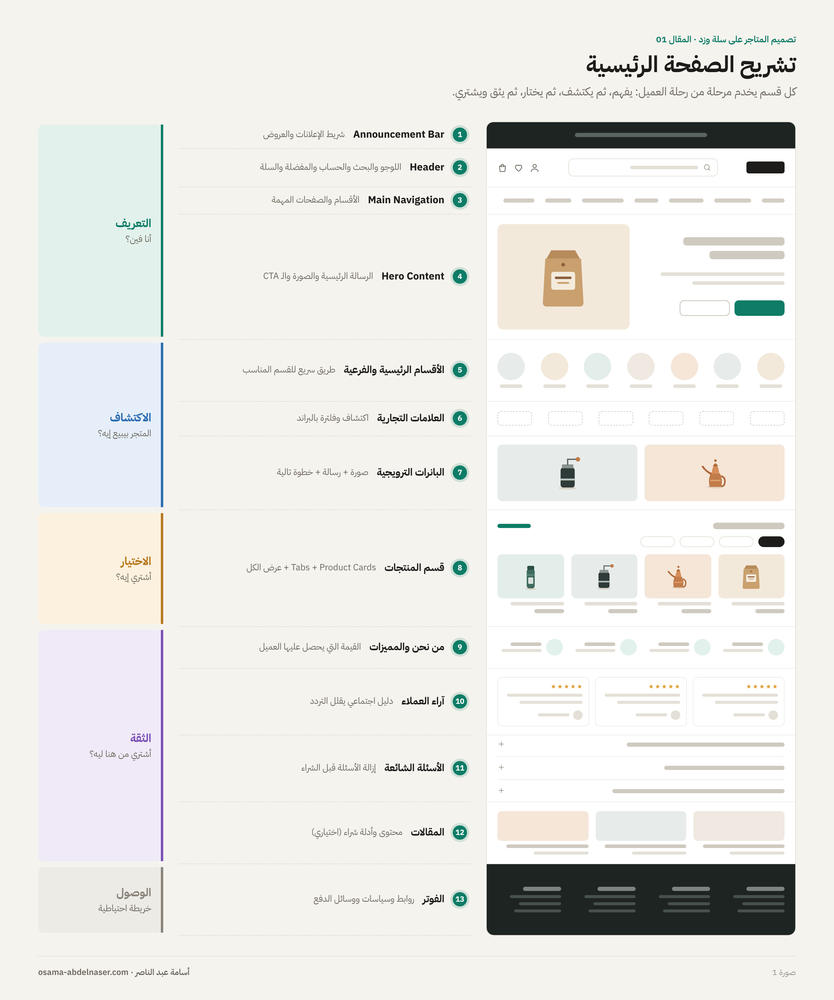

*صورة 1: تشريح الصفحة الرئيسية من أعلى لأسفل، مقسمة حسب مراحل رحلة العميل.*

## الـ Hero Section: الانطباع الأول

الـ Hero هو أهم قسم في الصفحة وأبرزها. وظيفته ليست أن يكون جميلًا فقط، بل أن يجيب بسرعة عن خمسة أسئلة في ذهن العميل:

- أنا فين؟
- المتجر بيبيع إيه؟
- إيه أهم حاجة أقدر أعملها هنا؟
- إيه العرض أو القيمة اللي بيقدمها المتجر؟
- أوصل للمنتج اللي عايزه إزاي؟

### مكونات الـ Hero الستة

| # | المكوّن | ماذا يحتوي | نصيحة من التجربة |
| --- | --- | --- | --- |
| 1 | Announcement Bar | عروض، خصومات، شحن مجاني، حملات موسمية، رسائل مهمة | رسالة واحدة واضحة أفضل من خمس رسائل تتبدل بسرعة |
| 2 | Header & Primary Actions | Logo، Search، Login / Account، Cart، Wishlist | الـ Search والـ Cart أهم نقطتي تفاعل؛ يجب أن يظهرا دائمًا، حتى على الموبايل |
| 3 | Main Navigation | الأقسام الرئيسية والفرعية، Brands، Offers، New Arrivals، الصفحات المهمة | الهدف أقصر طريق للمنتج، وليس أكبر عدد من الروابط |
| 4 | Secondary Promotional Bar | عروض منتجات، حملات، رسائل شحن مرتبطة بالأقسام | اختياري؛ أضفه فقط لو يحمل رسالة مختلفة عن الشريط الأول |
| 5 | Utility Bar | اللغة، العملة، العروض، معلومات الشحن | كل عنصر إضافي يضغط على الـ Visual Hierarchy، فاسأل: هل يحتاجه العميل هنا؟ |
| 6 | Main Hero Content | Main Visual، Headline، Description، Primary CTA، Secondary CTA عند الحاجة | العنوان يقول القيمة، والـ CTA يقول الخطوة التالية |

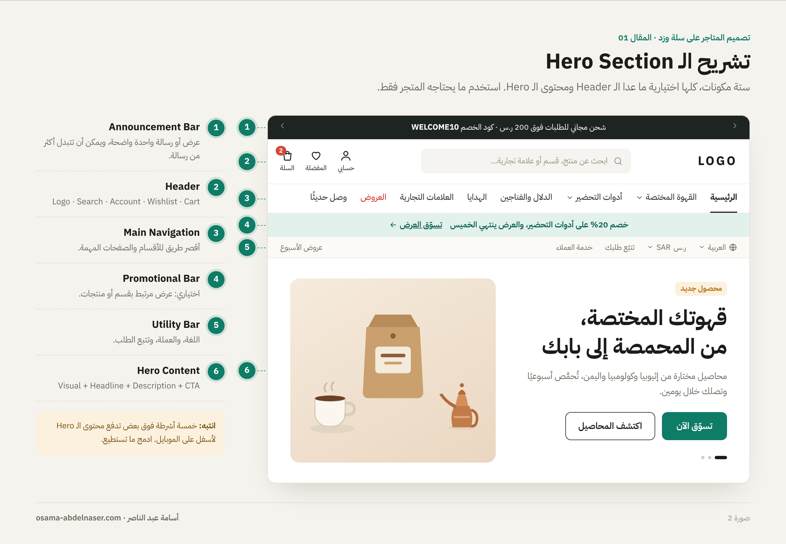

*صورة 2: تشريح الـ Hero ومكوناته الستة في متجر عربي (RTL).*

**انتبه لتكدّس الأشرطة.** لو استخدمت الخمسة أشرطة كلها فوق بعض، سيُدفع محتوى الـ Hero الحقيقي لأسفل، خصوصًا على الموبايل. الحل غالبًا: ادمج الـ Utility Bar داخل الـ Header، وانقل الـ Navigation إلى قائمة جانبية (Drawer) على الموبايل.

### لا يوجد شكل واحد للـ Hero

اختر الشكل حسب ما يريد المتجر أن يقوله أولًا:

- **صورة + نص (Split):** الأكثر أمانًا؛ مناسب لأغلب المتاجر.
- **فيديو:** عندما تكون الحركة أو طريقة الاستخدام جزءًا من قيمة المنتج.
- **Product-focused:** عندما يبيع المتجر منتجًا بطلًا واحدًا أو عددًا قليلًا من المنتجات.
- **Campaign-focused:** للحملات والمواسم مثل رمضان واليوم الوطني والجمعة البيضاء.
- **Editorial:** للبراندات التي تبيع أسلوب حياة وقصة، وليس منتجًا فقط.
- **Collection-focused:** عندما يريد العميل أن يرى التنوع من أول نظرة.

المهم في كل الحالات: واضح، سريع الفهم، ومتوافق مع هوية الـ Brand.

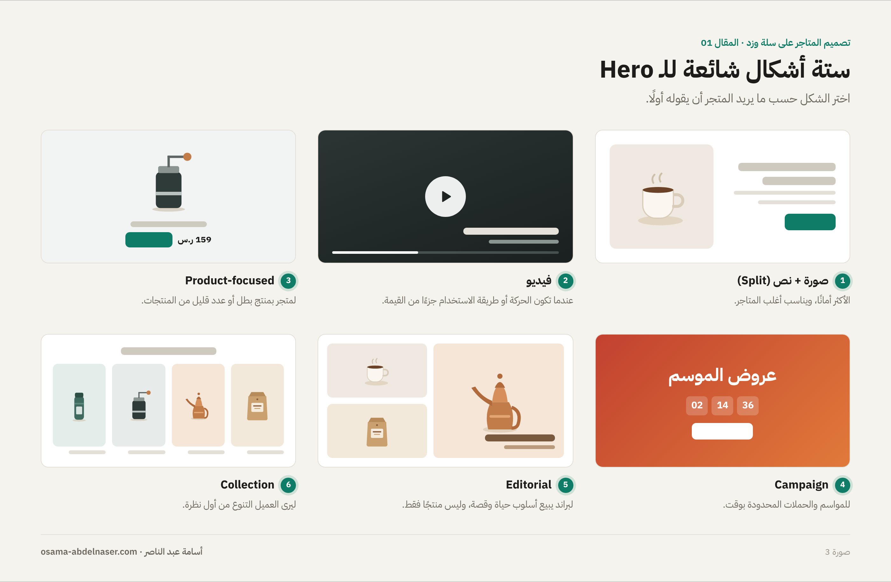

*صورة 3: ستة أشكال شائعة للـ Hero، ومتى تستخدم كل شكل.*

## الأقسام الرئيسية والفرعية

بعد الـ Hero، مهمتك أن توصّل العميل إلى القسم المناسب بأقل عدد من الضغطات. يمكنك عرض الأقسام الرئيسية وحدها، أو الجمع بين الرئيسية والفرعية في نفس المكان.

### طرق العرض الشائعة

- **Category Cards بالصور:** مناسبة عندما تكون الأقسام بصرية، مثل الأثاث والإلكترونيات والعطور.
- **دوائر أو أيقونات في Horizontal Scroller:** مناسبة للأقسام الكثيرة، وممتازة على الموبايل.
- **Grid:** مناسب لعدد محدود من الأقسام الرئيسية (من 4 إلى 8 تقريبًا).
- **Tabs:** عندما تكون الأقسام كثيرة؛ القسم الرئيسي في التاب، والفرعية تحته. هذا يقلل الـ Visual Clutter.

وفي نهاية القسم، أضف CTA مثل **عرض كل المنتجات** لتوجيه العميل إلى صفحة المنتجات.

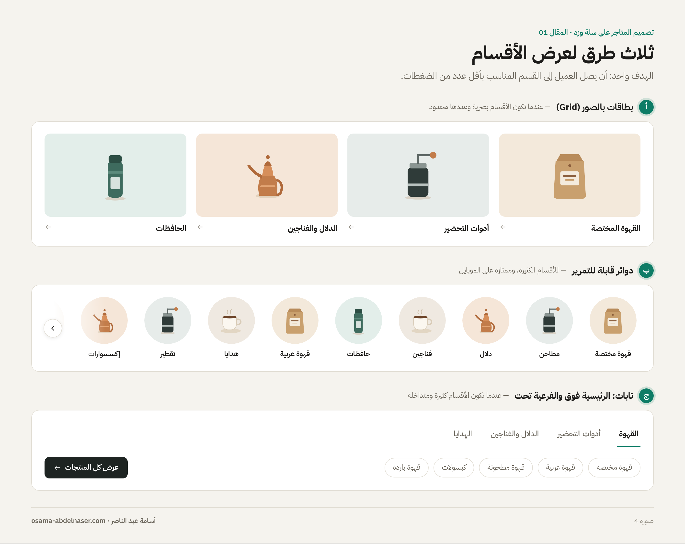

*صورة 4: ثلاث طرق لعرض الأقسام: بطاقات بالصور، ودوائر قابلة للتمرير، وتابات تجمع الرئيسية مع الفرعية.*

**صمّم للبيانات الحقيقية.** في سلة وزد، التاجر هو من يضيف الأقسام من لوحة التحكم. قد تكون 3 أقسام أو 30، وقد يكون اسم القسم كلمة أو سطرين. اختبر تصميمك على الحالتين قبل التسليم.

**وحّد صور الأقسام:** نفس الأبعاد، ونفس الخلفية، ونفس أسلوب التصوير. صور غير متناسقة تجعل القسم يبدو عشوائيًا مهما كان التصميم جيدًا.

## العلامات التجارية (Brands)

في المتاجر متعددة العلامات، مثل الإلكترونيات والعطور وقطع الغيار، العميل كثيرًا ما يبحث بالبراند قبل المنتج. هنا يصبح قسم الـ Brands وسيلة **اكتشاف وفلترة**، وليس مجرد شريط شعارات للزينة.

طرق العرض:

- Brand Logos في شريط أفقي أو Slider.
- Brand Cards بصورة وشعار.
- Brand Categories، أي تجميع البراندات حسب القسم.

كل شعار يجب أن يفتح صفحة البراند بمنتجاته. ثيمات سلة مثلًا تأتي بمكوّن جاهز لعرض شعارات البراندات، وبصفحات مخصصة لقائمة البراندات وللبراند الواحد ([Salla Docs](https://docs.salla.dev/422558m0)).

**نصيحة:** وحّد مقاس الشعارات بصريًا، وليس رقميًا. شعار عريض وشعار مربع بنفس العرض لن يبدوا بنفس الحجم؛ ضعهما في إطار ثابت واضبط كل واحد بالعين.

## البانرات والأقسام الترويجية

البانر ليس مجرد صورة. هو **Communication Component** يربط بين ثلاثة أشياء: صورة تلفت النظر، ونص يوضح الرسالة، وزر يحدد الخطوة التالية.

مكونات البانر:

- **Image:** صورة منتج أو قسم أو أجواء الحملة.
- **Heading:** الرسالة في كلمات قليلة.
- **Description:** سطر يوضح التفاصيل، مثل نسبة الخصم أو مدة العرض.
- **CTA:** فعل واضح، مثل «تسوّق العطور» بدلًا من «اضغط هنا».

يمكن استخدام البانرات للترويج لقسم معين، أو مجموعة منتجات، أو New Arrivals، أو العروض، أو الحملات الموسمية، أو قصة الـ Brand.

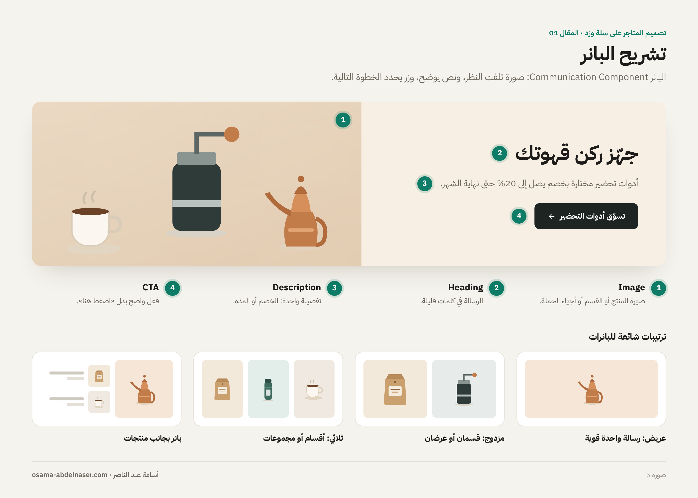

*صورة 5: تشريح البانر، وأربع طرق شائعة لترتيب البانرات.*

**القاعدة الذهبية:** متى سمح المكوّن، اجعل النص طبقة منفصلة فوق الصورة أو بجانبها، ولا تكتبه داخل الصورة نفسها. هكذا يقرأه محرك البحث، ويتغير مع اللغة، ولا يصبح غير مقروء على الموبايل. وإذا كان المكوّن الجاهز يقبل صورة فقط، صمّم نسختين من البانر: واحدة للديسكتوب وأخرى للموبايل بنص أكبر.

## قسم المنتجات والفلترة

قسم المنتجات ينقل العميل من مرحلة الاكتشاف إلى مرحلة الاختيار، لذلك هو من أهم أقسام الصفحة على الإطلاق.

يتكون عادةً من:

- **Section Title + Description:** ما هذه المجموعة؟ ولماذا تهمني؟
- **Tabs أو Filters:** مثل الكل، الأكثر مبيعًا، وصل حديثًا، العروض، الرائج.
- **Product Grid أو Carousel:** الـ Grid لمقارنة عدة منتجات في نظرة، والـ Carousel لتوفير المساحة.
- **View All CTA:** يوصل إلى صفحة كل المنتجات بالفلاتر الكاملة.

يمكنك تكرار القسم بأكثر من مجموعة في نفس الصفحة: Best Sellers، New Arrivals، Featured، Recommended، Offers، Trending، Recently Viewed.

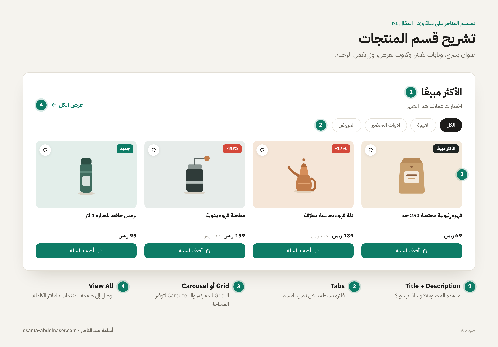

*صورة 6: قسم منتجات بعنوان وتابات فلترة وشبكة منتجات وزر «عرض الكل».*

قسم المنتجات يمكن تصميمه بألف شكل. لكن تذكّر أن الفلترة الكاملة مكانها صفحة قائمة المنتجات (Product Listing Page)، وهذا موضوع [المقال الثاني](../02-product-listing/README.md). في الصفحة الرئيسية، التابات البسيطة كافية.

## الـ Product Card: أهم Component في المتجر

الـ Product Card يتكرر عشرات أو مئات المرات داخل المتجر. أي قرار تصميمي فيه، صغيرًا كان أو كبيرًا، يتضاعف بعدد المنتجات.

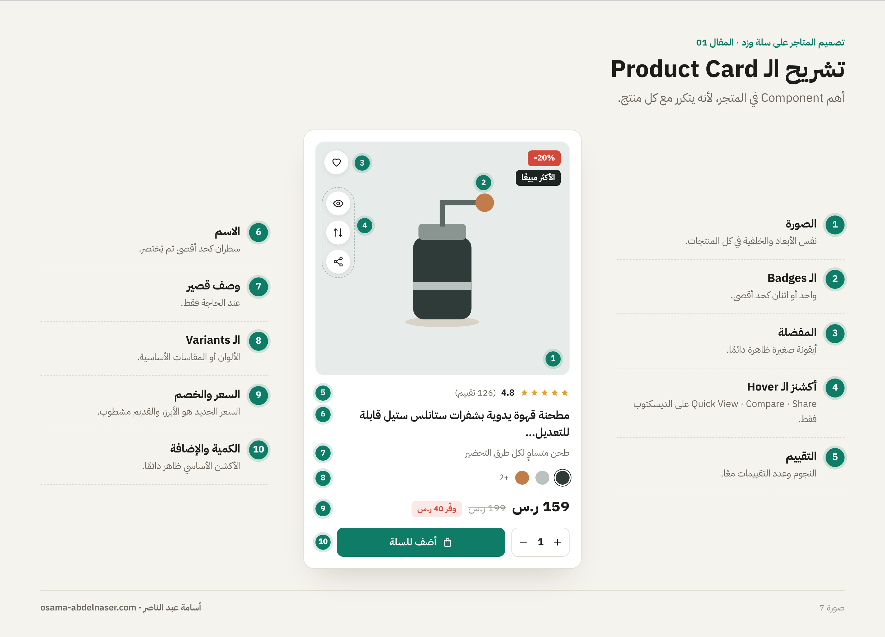

*صورة 7: تشريح الـ Product Card وعناصره الأساسية.*

### 1. صورة المنتج

أول ما يجذب العين. يجب أن تكون عالية الجودة وواضحة، وبنفس الأبعاد والخلفية في كل المنتجات، ومناسبة لنسبة الكارت. ويمكن إظهار صورة ثانية عند الـ Hover أو إضافة Gallery صغيرة.

### 2. معلومات المنتج

- **اسم المنتج:** سطران كحد أقصى في المتجر المخصص، ثم يُختصر بنقاط. لكن لو الثيم سيُنشر في متجر ثيمات سلة، فمتطلبات المراجعة تنص على ظهور اسم المنتج كاملًا دون اختصار في عناصر القوائم ([Salla Docs](https://docs.salla.dev/421887m0))، فصمّم الكارت ليتحمل الأسماء الطويلة.
- **وصف قصير:** عند الحاجة فقط.
- **السعر:** السعر بعد الخصم هو الأبرز، والسعر قبل الخصم أصغر ومشطوب، ونسبة الخصم في Badge.
- **التقييم والـ Variants:** مثل النجوم أو دوائر الألوان، حسب طبيعة المنتج.

### 3. الأكشنز: ليس كل ما يمكن يجب أن يظهر

> **الـ UI الجيد لا يعرض كل شيء؛ يعرض ما يحتاجه المستخدم في اللحظة المناسبة.**

| الأكشن | الأولوية | أين يظهر |
| --- | --- | --- |
| Add to Cart | أساسي | ظاهر دائمًا |
| Wishlist | ثانوي | أيقونة صغيرة ظاهرة دائمًا |
| Quick View | ثانوي | عند الـ Hover على الديسكتوب |
| Quantity Control | حسب المتجر | مفيد عندما تُشترى كميات، مثل البقالة والمنتجات الورقية والجملة |
| Compare | حسب المتجر | مفيد للإلكترونيات والأجهزة |
| Share / Copy Link | منخفض | غالبًا داخل صفحة المنتج |

**تذكّر: الموبايل لا يعرف الـ Hover.** أي أكشن تخفيه حتى يمر الماوس فوق الكارت سيختفي تمامًا على الموبايل. قرر من البداية ما يظهر دائمًا، وما ينتقل إلى صفحة المنتج.

### 4. الـ Tags والحالات

الـ Badges توضح حالة المنتج: Sale، New، Best Seller، Limited، Out of Stock، Low Stock، Coming Soon. ويمكن إضافة Countdown Timer للعروض المحدودة.

- Badge أو اثنان كحد أقصى في الكارت الواحد.
- لون ثابت لكل معنى في كل المتجر؛ الأحمر للخصم مثلًا، والرمادي لغير المتوفر.
- المنتج غير المتوفر: خفّف الصورة، واستبدل «أضف للسلة» بـ «أعلمني عند التوفر».

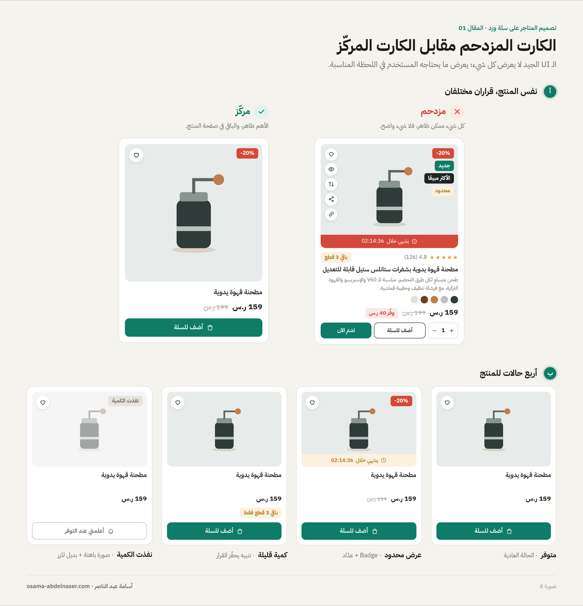

*صورة 8: الكارت المزدحم مقابل الكارت المركّز، وأربع حالات للمنتج.*

الهدف هنا هو **Communication**، وليس إضافة عناصر لمجرد أنها متاحة.

## أقسام الثقة: لماذا أشتري من هنا؟

بعد أن وجد العميل المنتج، يبقى سؤال واحد: هل أثق في هذا المتجر؟ أربعة أقسام تجيب عن هذا السؤال.

### من نحن والمميزات (Value Proposition)

لا تكتب فقرة عن تاريخ البراند. اكتب ما يستفيده العميل: جودة المنتجات، سرعة التوصيل، الضمان، الاسترجاع، خدمة العملاء. الشكل الأشهر هنا: 3 أو 4 مميزات، لكل ميزة أيقونة وعنوان قصير وسطر واحد.

### آراء العملاء

من أهم عناصر بناء الثقة، لأنها تقلل الـ Trust Barrier قبل قرار الشراء. يمكن عرض التقييمات، والـ Testimonials، وصور العملاء للمنتج (User Generated Content). الرأي الذي يذكر تفصيلة حقيقية عن المنتج أقوى من عشرة آراء تقول «ممتاز».

### الأسئلة الشائعة (FAQ)

تزيل الـ Friction قبل الشراء: الشحن، والدفع، والاسترجاع والاستبدال، ومدة التوصيل، والمقاسات، والضمان. استخدم Accordion حتى لا يطول القسم، واجعل أهم سؤالين مفتوحين أو في الأعلى.

### المقالات (Blog)

أضفها عندما يكون المحتوى جزءًا من استراتيجية المتجر: أدلة شراء، وطرق استخدام، ونصائح، وتحسين ظهور المتجر في محركات البحث (SEO). وجود المقالات ليس إلزاميًا.

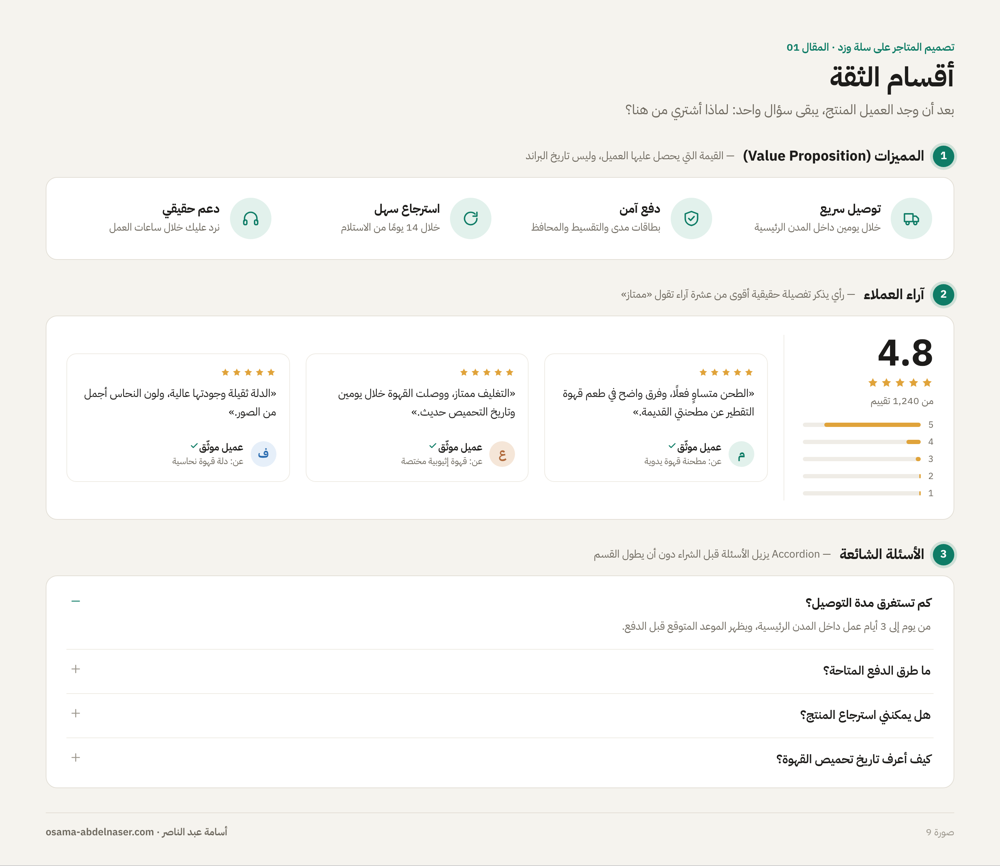

*صورة 9: ثلاثة أقسام للثقة: المميزات، وآراء العملاء، والأسئلة الشائعة.*

**على أرض الواقع:** ثيمات سلة تأتي بمكونات جاهزة لمميزات المتجر وآراء العملاء ([Salla Docs](https://docs.salla.dev/422558m0))، فابدأ منها وصمّم شكلها بما يناسب الـ Brand قبل أن تطلب مكوّنًا مخصصًا.

## الفوتر (Footer)

الفوتر آخر نقطة في الصفحة، لكنه جزء أساسي من الـ Information Architecture. العميل الذي وصل للفوتر غالبًا يبحث عن شيء لم يجده: سياسة الاسترجاع، أو رقم التواصل، أو قسم معين.

قسّم محتواه إلى مجموعات واضحة:

- **عن المتجر:** Logo، ونبذة قصيرة، وروابط السوشيال ميديا.
- **روابط التسوق:** الأقسام الرئيسية، والعروض، والجديد.
- **المساعدة:** الشحن والتوصيل، والاسترجاع والاستبدال، والأسئلة الشائعة، وتواصل معنا.
- **السياسات:** الشروط والأحكام، وسياسة الخصوصية.
- **الثقة:** أيقونات وسائل الدفع، وبيانات التوثيق التجاري والرقم الضريبي إن وُجدت.
- **Newsletter:** اختياري، وبحقل واحد فقط.

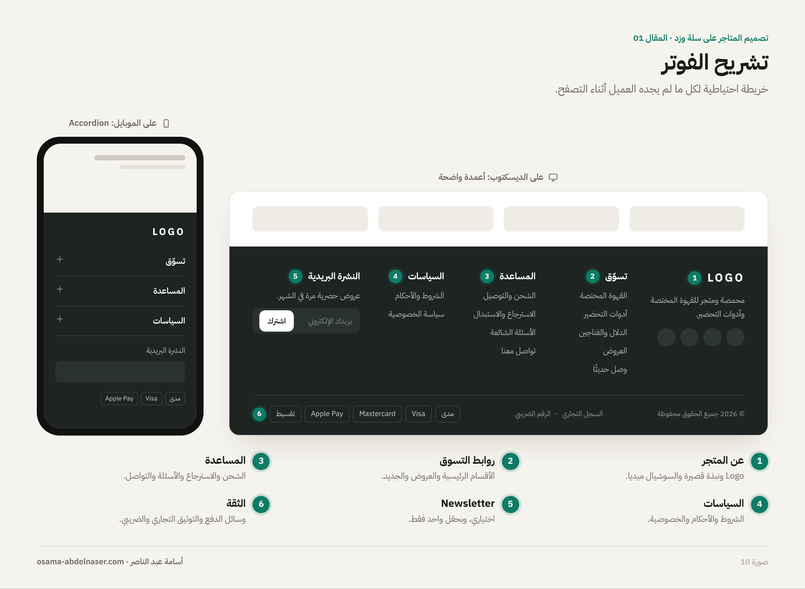

*صورة 10: تشريح الفوتر وتقسيمه إلى مجموعات.*

**على الموبايل:** حوّل أعمدة الروابط إلى Accordion، حتى لا يصبح الفوتر أطول من الصفحة نفسها.

## لا يوجد Layout واحد صحيح

كل ما سبق ليس وصفة ثابتة تُتبع حرفيًا. أنت تأخذ الأساس كـ Hint، ثم تبني عليه شيئًا أفضل.

- يمكنك تغيير ترتيب الأقسام بالكامل.
- يمكنك إضافة أقسام جديدة، أو حذف أقسام، أو دمج أكثر من قسم في قسم واحد.
- يمكنك عرض المنتجات بالتابات أو السلايدر أو الـ Grid أو بأسلوب Editorial.
- يمكنك بناء تجربة مختلفة تمامًا، إذا كانت تخدم الـ Brand والعميل.

متجر يبيع منتجًا واحدًا لا يحتاج قسم أقسام ولا قسم براندات. ومتجر قطع غيار بآلاف المنتجات يحتاج البحث والأقسام قبل أي بانر جميل.

خذ الـ Structure كـ **Foundation وليس Rulebook**. واترك لخيالك الإبداع، بشرط أن يبقى في حدود ما يمكن تنفيذه على المنصة. وهذا هو موضوع القسم التالي.

## سلة وزد: صمّم وأنت فاهم المنصة

الفرق بين مصمم يرسم واجهة جميلة وبين Product Designer، أن الثاني يعرف ماذا سيحدث لتصميمه بعد التسليم. في Shopify مساحة الحرية أكبر، أما سلة وزد فلكل منهما حدود واضحة يجب أن تعرفها قبل أول Frame.

> **لا تصمم شيئًا بمعزل عن الـ Platform.**

### كيف تُبنى الثيمات اليوم؟

**سلة:** وثائق سلة الحالية تقدم نظام Twilight المبني على React، وتصنّف محرك Twilight القديم المبني على Twig كـ Deprecated. الفكرة الأساسية أن محرك الثيمات يوفر متجرًا كاملًا يعمل، والثيم يصف فقط ما يختلف عنه ([Salla Docs: Twilight React](https://docs.salla.dev/twilight/react/start/what-is-a-theme)). وفي الثيمات المبنية على المحرك القديم، الصفحة الرئيسية تتكون من مكونات جاهزة، مثل السلايدر والبانر الثابت وآراء العملاء ومميزات المتجر وسلايدر المنتجات والبراندات، بالإضافة إلى مكونات يبنيها المطور خصيصًا، والتحكم في إظهارها وإخفائها من بوابة الشركاء ([Salla Docs: Home Page](https://docs.salla.dev/422558m0)).

**زد:** ثيمات زد أصبحت تُبنى على نظام Vitrin باستخدام قوالب Jinja وSettings Schema، والثيمات المبنية على Twig أصبحت Deprecated وتحتاج إلى ترحيل. ومن الأشياء المهمة للمصمم: إذا لم يصمم الثيم صفحة معينة، تستخدم زد الصفحة الافتراضية من ثيمها الأساسي. وزد توصي بعدم تثبيت الألوان والخطوط والمسافات داخل الكود، بل سحبها من إعدادات الثيم حتى يغيّرها التاجر بنفسه ([Zid Docs](https://docs.zid.sa/theme-development.md)).

**الدرس:** المنصتان غيّرتا محركاتهما مؤخرًا. قبل أن تعد العميل بأي شيء، راجع آخر نسخة من الوثائق، واسأل المطور.

### سلّم القرار: ابدأ بأصغر تغيير

وثائق سلة نفسها تنصح المطور بأن يبدأ بأصغر تغيير ممكن: إعداد، ثم إضافة في مكان محدد، ثم Component، ثم صفحة كاملة ([Salla Docs](https://docs.salla.dev/twilight/react/start/what-is-a-theme)). نفس السلّم يصلح للمصمم، ويجيب عن أربعة أسئلة: ماذا يمكن تصميمه؟ وماذا يمكن ضبطه بالإعدادات؟ وماذا يحتاج تطويرًا؟ وماذا غير ممكن؟

| المستوى | مثال | من ينفذه | التكلفة |
| --- | --- | --- | --- |
| 1. إعداد (Setting) | الألوان والخطوط، وصور البانرات، وإظهار قسم أو إخفاؤه | التاجر من لوحة التحكم | الأقل |
| 2. إضافة في مكان محدد | شارة «شحن مجاني» تحت السعر | المطور | منخفضة |
| 3. Component مخصص | Product Card بتصميم جديد، أو قسم آراء بشكل مختلف | المطور | متوسطة |
| 4. صفحة أو تجربة كاملة | تجربة تخصيص منتج، أو صفحة تفاعلية خاصة | مطور بخبرة | الأعلى، وقد لا تكون ممكنة |

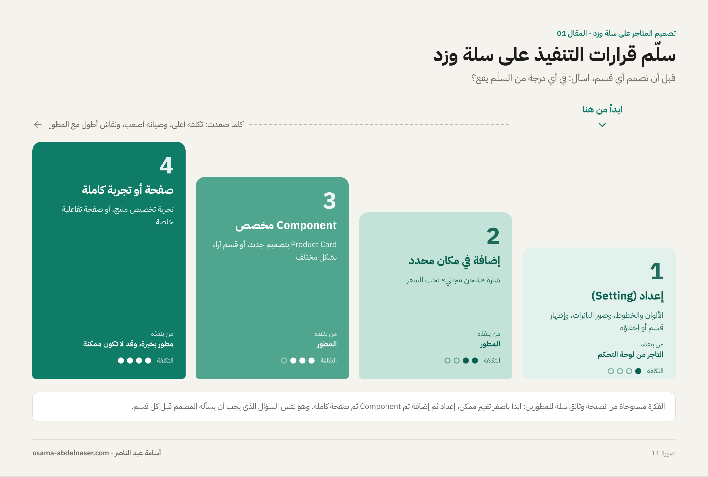

*صورة 11: سلّم قرارات التنفيذ، من الإعداد البسيط حتى التطوير الكامل.*

كل ما تصممه في المستوى الأول يعني متجرًا أسهل في الصيانة، وتاجرًا يستطيع التعديل بنفسه. وكل ما يصعد في السلّم يحتاج نقاشًا مع المطور قبل التسليم.

### ثيم لمتجر واحد، أم ثيم للمتجر العام؟

هذان نوعان مختلفان من العمل:

- **تصميم متجر لبراند واحد:** حرية أكبر في حكي قصة الـ Brand، لأنك تعرف المنتجات والصور والجمهور.
- **تصميم ثيم يُباع في متجر ثيمات سلة:** سيستخدمه تجار مختلفون بمنتجات وصور وأسماء لا تعرفها. هنا المرونة أهم من أي شيء: إعدادات للألوان والخطوط، وأقسام تُظهر وتُخفى، وتصميم يصمد أمام صور ضعيفة وأسماء طويلة. سلة تراجع الثيم قبل نشره، وتشترط أن يكون مختلفًا بوضوح عن ثيمها الأساسي «رائد»، وأن لا يتجاوز حجم الثيم العام 1MB ([Salla Docs](https://docs.salla.dev/421886m0)). ومراجعة الـ UI/UX تشمل الـ Layout والـ Typography والـ Art Direction والاتساق وتجربة العميل ([Salla Docs](https://docs.salla.dev/421887m0)).

### قبل أول Frame

- افتح الثيم الافتراضي للمنصة وادرس مكوناته: ثيم «رائد» في سلة، وثيمات العينة التي تشاركها زد على GitHub.
- استخدم الـ Figma Template الذي توفره سلة لثيماتها ضمن وثائقها ([Salla Docs](https://docs.salla.dev/421885m0)).
- ابنِ الألوان والخطوط والمسافات كـ Design Tokens، لأنها ستتحول إلى إعدادات يغيّرها التاجر.
- اتفق مع المطور على حالة كل Component: جاهز كما هو، أم معدّل، أم مخصص بالكامل.

## ما وراء الأقسام: الصور والأيقونات والخطوط

القيمة الحقيقية لا تأتي من عدد الأقسام، بل من جودة التفاصيل داخلها.

### الصور

الصورة الجيدة ترفع قيمة المنتج، والصورة الضعيفة تجعل منتجًا ممتازًا يبدو رخيصًا. اهتم بالدقة، والإضاءة، والتكوين، والاتساق بين الصور، ونسبة الأبعاد.

**نصيحة من التجربة:** سلّم التاجر «دليل تصوير» صغيرًا مع التصميم: نسبة الأبعاد المطلوبة، ولون الخلفية، والمسافة حول المنتج. التصميم الجميل يسقط عندما يرفع التاجر صورًا عشوائية بعد الإطلاق.

### الأيقونات

من مجموعة واحدة، وبنفس السُمك والأسلوب، وسهلة الفهم، ومناسبة لشخصية الـ Brand. ولا تضع أيقونة لمجرد أن المساحة تسمح.

### الخطوط (Typography)

اختيار الخط ليس قرارًا تجميليًا. يجب أن يناسب شخصية الـ Brand والجمهور، وأن يكون مقروءًا، ويصنع Hierarchy واضحة.

في المتاجر العربية تحديدًا:

- اختر خطًا عربيًا يعمل جيدًا مع الخط اللاتيني إذا كان المتجر ثنائي اللغة، أو عائلة خطوط تدعم اللغتين.
- اختبر الأرقام والأسعار، فهي أكثر نص يتكرر في المتجر.
- اختبر الاتجاهين RTL وLTR، لأن الأيقونات والأسهم والسلايدرات تنعكس.

## كل براند له قصة

هذه أهم نقطة في المقال كله: **كل Brand له شخصية وطابع وحكاية.** لذلك لا يجب أن تبدو كل المتاجر التي تصممها كأنها متجر واحد بعد تغيير الـ Logo والألوان.

الـ Brand يظهر في كل شيء: الـ UX Writing، ونبرة الصوت واللهجة، والخطوط، والصور والفيديوهات، والألوان، والأيقونات، والـ Layout، والمسافات، والـ Components، والحركة، والمحتوى.

| نوع البراند | كيف يظهر في التصميم | مثال على الـ CTA |
| --- | --- | --- |
| فاخر (عطور، عود) | مساحات واسعة، ألوان هادئة، خط أنيق، صور قريبة بإضاءة درامية، كلام قليل | اكتشف المجموعة |
| تقليدي (تمور، قهوة) | ألوان ترابية، لمسات مستوحاة من التراث، لغة دافئة قريبة | اطلب قهوتك |
| مرح (مستلزمات الحيوانات الأليفة) | ألوان مبهجة، زوايا دائرية، رسومات خفيفة، لغة ودودة | دلّع قطتك |
| تقني (إلكترونيات، قطع كمبيوتر) | Grid منظم، مواصفات واضحة، فلاتر قوية، لغة مباشرة | قارن المواصفات |
| شبابي (أزياء عصرية) | جرأة في الـ Layout، صور بأسلوب Editorial، حركة أكثر | شوف الجديد |

لو الـ Brand فاخر، يجب أن تشعر بذلك. ولو مرح، يجب أن تشعر بذلك. الـ UI ليس عناصر مرصوصة بجانب بعضها؛ هو وسيلة تحكي بها قصة الـ Brand، وتلامس بها قلب المنتج، وتبني علاقة بين العميل والبراند.

## الخلاصة: التجربة أكبر من الواجهة

تصميم متجر إلكتروني ليس **Sections + Cards + Buttons + Colors**. هو مزيج من ستة أسئلة، تجيب عنها كلها معًا:

- **UX:** كيف يصل العميل إلى ما يريد؟
- **UI:** كيف نجعل التجربة واضحة وسهلة وجميلة؟
- **Brand:** كيف تعبّر التجربة عن شخصية المتجر؟
- **Content:** ماذا نقول للعميل؟ وكيف نقوله؟
- **Technology:** ماذا نستطيع أن ننفذ فعليًا على سلة أو زد؟
- **Business:** ما الهدف الذي يريد التاجر تحقيقه؟

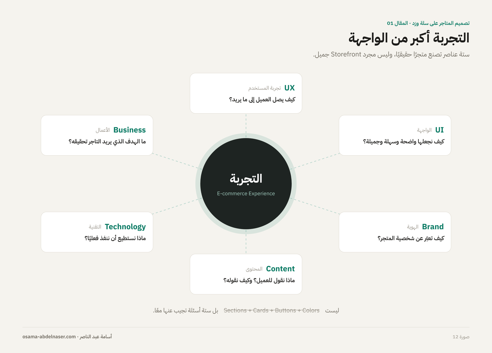

*صورة 12: العناصر الستة التي تصنع تجربة المتجر.*

عندما تجمع هذه العناصر، تتوقف عن تصميم Storefront جميل، وتبدأ في بناء **E-commerce Experience حقيقية**.

## قائمة مراجعة قبل تسليم الصفحة الرئيسية

استخدمها مع كل مشروع قبل أن ترسل التصميم للعميل أو للمطور:

- [ ] الـ Hero يجيب في نظرة واحدة: ماذا يبيع المتجر، وما الخطوة التالية.
- [ ] الـ Search والـ Cart ظاهران دائمًا على الديسكتوب والموبايل.
- [ ] الأشرطة فوق الـ Hero لا تدفع المحتوى الرئيسي خارج الشاشة على الموبايل.
- [ ] قسم الأقسام مُختبر مع 3 أقسام ومع 30 قسمًا، ومع الأسماء الطويلة.
- [ ] الـ Product Card مُختبر مع اسم طويل، ومنتج بخصم، ومنتج غير متوفر.
- [ ] لا يوجد أكشن مهم مخفي خلف الـ Hover فقط.
- [ ] كل Badge له لون ثابت ومعنى واحد في كل المتجر.
- [ ] نصوص البانرات مقروءة على الموبايل.
- [ ] الخط العربي واللاتيني متناسقان، والأرقام والأسعار واضحة.
- [ ] كل قسم مصنّف: إعداد جاهز، أم تعديل، أم Component مخصص، ومتفق عليه مع المطور.
- [ ] دليل تصوير مختصر جاهز لتسليمه للتاجر.
- [ ] الـ Brand واضح في الكلام والصور والتفاصيل، وليس في الـ Logo والألوان فقط.

## المصادر

- [Salla Docs: Twilight (React) Overview](https://docs.salla.dev/twilight/react/start/what-is-a-theme)
- [Salla Docs: Home Page](https://docs.salla.dev/422558m0)
- [Salla Docs: Main Requirements](https://docs.salla.dev/421886m0)
- [Salla Docs: UI / UX Review](https://docs.salla.dev/421887m0)
- [Salla Docs: Requirements & Review Overview](https://docs.salla.dev/421885m0)
- [Zid Docs: Theme Development](https://docs.zid.sa/theme-development.md)

---

**المقال التالي:** [02 — صفحة قائمة المنتجات والفلترة](../02-product-listing/README.md)

