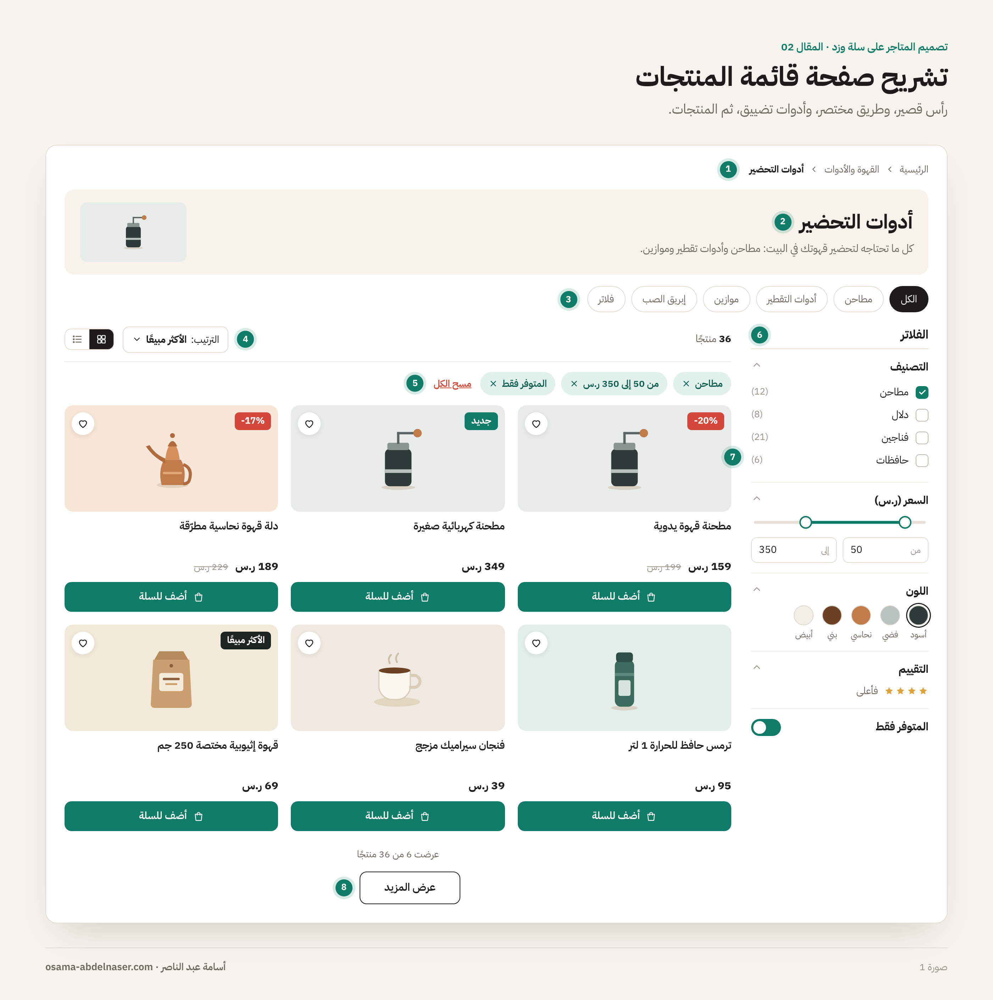
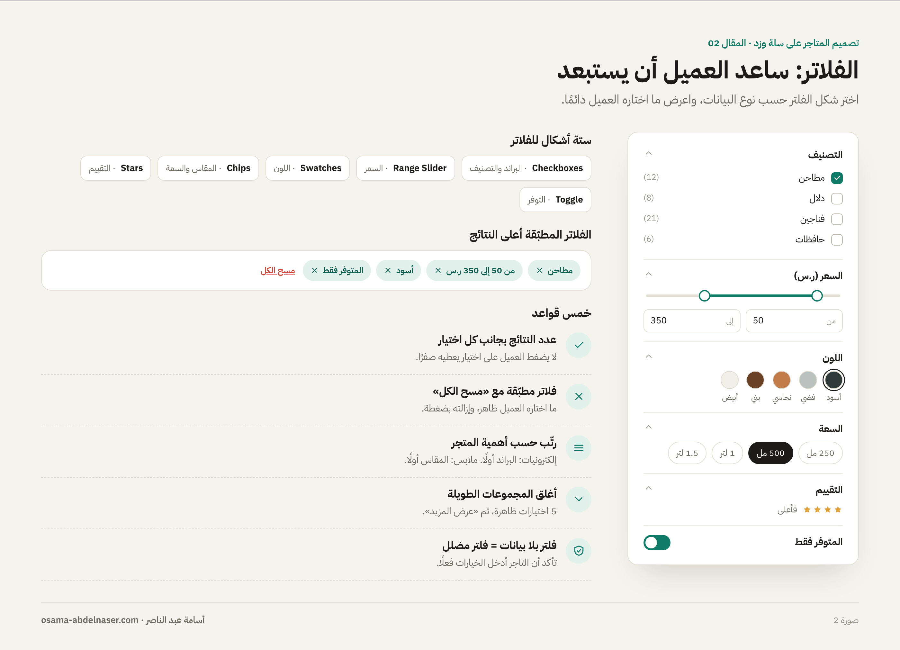
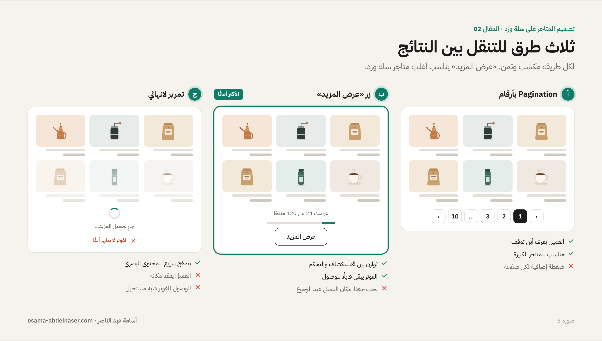
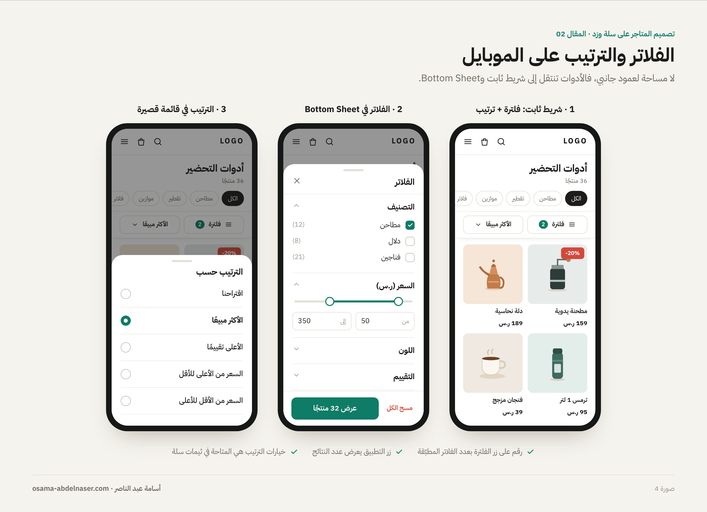
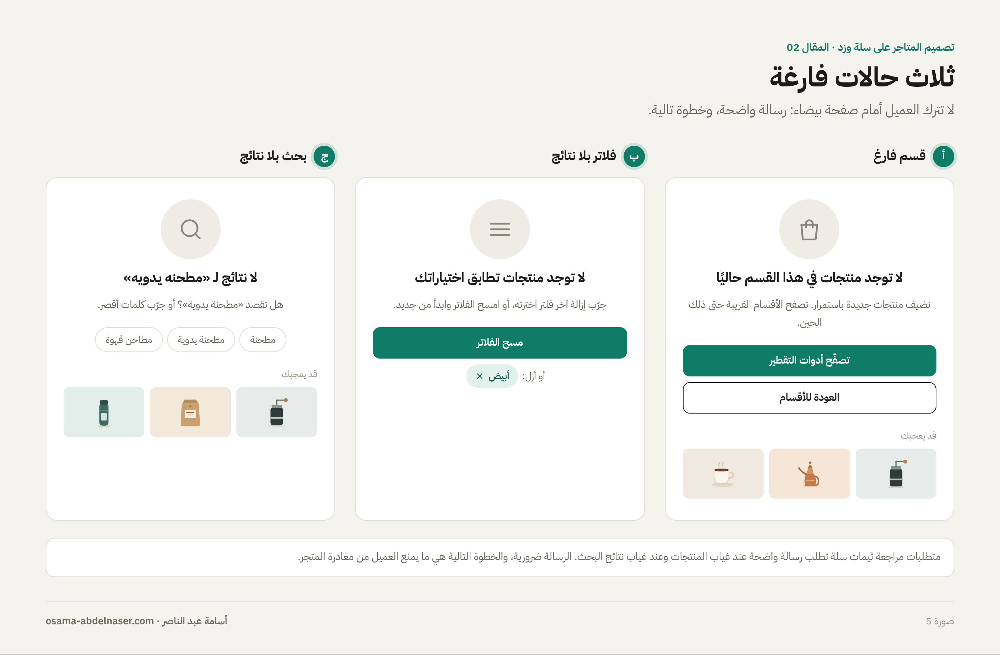

# 02 — صفحة قائمة المنتجات والفلترة

**سلسلة تصميم المتاجر الإلكترونية على سلة وزد · المقال 02**
بقلم: أسامة عبد الناصر · مصمم منتجات رقمية UX/UI · نوفمبر 2026

**[اقرأ المقال على موقع السلسلة ←](https://osa98.github.io/salla-zid-ecommerce-design/02-product-listing.html)**

> **ملاحظة مهمة قبل التصميم:** متطلبات مراجعة ثيمات سلة تطلب في عناصر القوائم أن يظهر اسم المنتج كاملًا دون اختصار، وألا تنكسر الشبكة عندما تختلف نسب الصور، وأن تظهر رسالة واضحة عندما لا يحتوي القسم على منتجات ([Salla Docs](https://docs.salla.dev/421887m0)). التفاصيل في ملف [ملاحظات وتحديثات مهمة](../../NOTES.md).

---

## الصفحة التي يقارن فيها العميل

في الصفحة الرئيسية يكتشف العميل المتجر. أما في صفحة قائمة المنتجات (Product Listing Page) فهو يقارن ويضيّق الاختيارات حتى يصل إلى منتج واحد. لذلك نجاح هذه الصفحة يقاس بسؤال واحد: **كم خطوة يحتاج العميل ليصل إلى المنتج المناسب؟**

العميل يصل إلى هذه الصفحة من أكثر من باب، والصفحة نفسها تخدمها كلها:

- **قسم أو قسم فرعي:** مثل «أدوات التحضير».
- **علامة تجارية:** كل منتجات براند واحد.
- **عروض أو Tag:** مثل «العروض» أو «وصل حديثًا».
- **نتائج البحث:** ما كتبه العميل في خانة البحث.

في سلة مثلًا، صفحة قائمة المنتجات تعرض منتجات من قسم أو عرض أو Tag أو نتائج بحث ([Salla Docs](https://docs.salla.dev/422559m0)). وفي زد توجد قوالب منفصلة لصفحة القسم، وصفحة كل المنتجات، وصفحة البراند ([Zid Docs](https://docs.zid.sa/overview-1379323m0)). التصميم واحد في الأساس، مع اختلاف رأس الصفحة حسب المصدر.

## تشريح الصفحة

*صورة 1: تشريح صفحة قائمة المنتجات على الديسكتوب.*

| # | العنصر | وظيفته |
| --- | --- | --- |
| 1 | Breadcrumb | يخبر العميل أين هو، ويعيده خطوة للخلف بضغطة |
| 2 | رأس القسم | العنوان والوصف وصورة القسم |
| 3 | الأقسام الفرعية | طريق مختصر قبل الفلاتر |
| 4 | شريط الأدوات | عدد النتائج، والترتيب، وتبديل طريقة العرض |
| 5 | الفلاتر المطبّقة | ما اختاره العميل، مع إزالة سريعة |
| 6 | الفلاتر | تضييق النتائج حسب السعر والبراند والخيارات |
| 7 | شبكة المنتجات | الـ Product Cards نفسها |
| 8 | التنقل بين الصفحات | Pagination أو «عرض المزيد» |

## رأس القسم: قصير ومفيد

رأس القسم يقول للعميل إنه في المكان الصحيح. متطلبات مراجعة ثيمات سلة تطلب في صفحة القسم أن يظهر العنوان كاملًا، ووصف القسم، وصورته ([Salla Docs](https://docs.salla.dev/421887m0)).

- **العنوان:** اسم القسم كما هو، بدون اختصار.
- **الوصف:** سطر أو سطران فقط. الوصف الطويل المكتوب للـ SEO مكانه أسفل الصفحة، بعد المنتجات.
- **الصورة:** اختيارية في التصميم، لكن صمّم لها مكانًا يتحمل غيابها؛ ليس كل تاجر سيرفع صورة لكل قسم.

**الخطأ الشائع:** بانر ضخم أعلى القسم يدفع المنتجات أسفل الشاشة. العميل جاء ليرى المنتجات، فاجعل أول صف منها ظاهرًا من أول نظرة، خصوصًا على الموبايل.

## الأقسام الفرعية: الطريق المختصر

قبل أن يفتح العميل الفلاتر، اعرض له الأقسام الفرعية كـ Chips أفقية أسفل رأس القسم. ضغطة واحدة على «مطاحن» أسرع من فتح الفلتر واختيار التصنيف. وإذا كانت كثيرة، اجعلها قابلة للتمرير الأفقي على الموبايل.

## الفلاتر: ساعد العميل أن يستبعد

الفلتر الجيد لا يعرض كل البيانات الموجودة؛ يعرض ما يساعد العميل على الاستبعاد بسرعة. اختر الفلاتر حسب طبيعة المتجر:

| نوع الفلتر | الشكل المناسب | مثال |
| --- | --- | --- |
| قائمة اختيارات | Checkboxes مع عدد النتائج | البراند، التصنيف |
| مدى رقمي | Range Slider مع حقلين للأرقام | السعر |
| لون | دوائر ألوان مع اسم اللون | لون المنتج |
| مقاس أو سعة | Chips | المقاس، الحجم، السعة |
| تقييم | نجوم «فأعلى» | 4 نجوم فأعلى |
| توفر | Toggle | المتوفر فقط |

*صورة 2: أنواع الفلاتر، والفلاتر المطبّقة، وعدد النتائج.*

### قواعد تجعل الفلتر مفيدًا

- **اعرض عدد النتائج** بجانب كل اختيار؛ العميل لا يحب أن يضغط على اختيار يعطيه صفرًا.
- **أظهر الفلاتر المطبّقة** كـ Chips أعلى النتائج، مع زر «مسح الكل».
- **رتّب الفلاتر حسب الأهمية:** في متجر إلكترونيات البراند أولًا، وفي متجر ملابس المقاس أولًا.
- **أغلق المجموعات الطويلة:** أظهر 5 اختيارات، ثم «عرض المزيد».
- **لا تحذف الفلتر بعد التطبيق:** العميل يجب أن يرى ما اختاره، ويعدّله بسهولة.

**على أرض الواقع:** في سلة، توجد إعدادات لتصفية وفلترة المنتجات يضبطها التاجر من لوحة التحكم ([مركز مساعدة سلة](https://help.salla.sa/article/%D8%AA%D8%B5%D9%81%D9%8A%D8%A9-%D9%88%D9%81%D9%84%D8%AA%D8%B1%D8%A9-%D8%A7%D9%84%D9%85%D9%86%D8%AA%D8%AC%D8%A7%D8%AA/fj9xwn0a8ear6hegg2mm5qyy)). قبل أن تصمم فلترًا، تأكد مع التاجر والمطور أن بياناته موجودة فعلًا؛ فلتر «المقاس» لا قيمة له إذا لم يُدخل التاجر المقاسات كخيارات للمنتج.

## الترتيب (Sort)

الترتيب يجيب عن سؤال مختلف عن الفلتر: الفلتر يقول «أرني هذا فقط»، والترتيب يقول «أرني الأهم أولًا». في ثيمات سلة، خيارات الترتيب المتاحة في صفحة القائمة هي: اقتراحنا، والأكثر مبيعًا، والأعلى تقييمًا، والسعر من الأعلى للأقل، والسعر من الأقل للأعلى ([Salla Docs](https://docs.salla.dev/422559m0)).

- اجعل الترتيب قائمة منسدلة صغيرة بجانب عدد النتائج على الديسكتوب.
- على الموبايل، اجعله زرًا بجانب زر الفلتر يفتح Bottom Sheet.
- أظهر الترتيب الحالي دائمًا في الزر نفسه، مثل «الترتيب: الأكثر مبيعًا».

## شبكة المنتجات

- **عدد الأعمدة:** غالبًا 4 على الديسكتوب العريض، و3 مع وجود الفلاتر الجانبية، و2 على الموبايل.
- **نسب الصور:** اختر نسبة واحدة للكارت، واجعل الصورة تتكيف داخلها. التاجر سيرفع صورًا بنسب مختلفة، والشبكة يجب ألا تنكسر.
- **الاسم الكامل:** في الثيمات المنشورة على متجر ثيمات سلة، اسم المنتج يظهر كاملًا. صمّم الكارت ليرتفع بشكل متناسق مع الأسماء الطويلة.
- **تبديل طريقة العرض (Grid / List):** مفيد في المتاجر التقنية التي يحتاج فيها العميل إلى مواصفات أكثر، وغير ضروري في أغلب المتاجر الأخرى.

## Pagination أم «عرض المزيد» أم التمرير اللانهائي؟

| الطريقة | متى تناسب | ماذا تخسر |
| --- | --- | --- |
| Pagination بأرقام | المتاجر الكبيرة، والعميل الذي يريد أن يعرف أين توقف | ضغطة إضافية لكل صفحة |
| زر «عرض المزيد» | أغلب المتاجر؛ توازن بين الاستكشاف والتحكم | يجب حفظ مكان العميل عند الرجوع للخلف |
| تمرير لانهائي | المحتوى البصري والتصفح العشوائي | الوصول للفوتر شبه مستحيل، والعميل يفقد مكانه |

*صورة 3: ثلاث طرق للتنقل بين النتائج، ومتى تستخدم كل طريقة.*

**نصيحتي:** «عرض المزيد» مع نص صغير مثل «عرضت 24 من 120 منتجًا» هو الخيار الأكثر أمانًا لأغلب متاجر سلة وزد.

## الموبايل: الفلاتر في Bottom Sheet

على الموبايل لا توجد مساحة لعمود جانبي. الحل المعتاد:

1. **شريط ثابت (Sticky)** أعلى النتائج فيه زرّان: «فلترة» و«ترتيب».
2. **Bottom Sheet للفلاتر** يغطي أغلب الشاشة، بمجموعات قابلة للطي.
3. **زر تطبيق ثابت** أسفل الشاشة يعرض عدد النتائج، مثل «عرض 32 منتجًا».
4. **رقم على زر الفلترة** يوضح عدد الفلاتر المطبّقة.

*صورة 4: شريط الأدوات الثابت، وBottom Sheet للفلاتر، وقائمة الترتيب على الموبايل.*

## الحالات الفارغة: لا تترك العميل أمام صفحة بيضاء

متطلبات مراجعة ثيمات سلة تطلب رسالة واضحة عندما لا يحتوي القسم على منتجات، وعندما لا توجد نتائج بحث ([Salla Docs](https://docs.salla.dev/421887m0)). لكن الرسالة وحدها لا تكفي؛ أعطِ العميل خطوة تالية:

- **قسم فارغ:** «لا توجد منتجات في هذا القسم حاليًا» + روابط لأقسام قريبة.
- **فلاتر بلا نتائج:** «لا توجد منتجات تطابق اختياراتك» + زر «مسح الفلاتر» + اقتراح بإزالة آخر فلتر.
- **بحث بلا نتائج:** اعرض ما كتبه العميل، واقترح تصحيحًا أو كلمات قريبة، واعرض الأكثر مبيعًا.

*صورة 5: ثلاث حالات فارغة، ولكل حالة خطوة تالية واضحة.*

**نتائج البحث ليست منتجات فقط:** متطلبات سلة تشير إلى أن صفحة البحث تعرض أنواعًا مختلفة من النتائج، مثل المنتجات والمقالات والصفحات ([Salla Docs](https://docs.salla.dev/421887m0)). صمّم لكل نوع شكلًا يميزه.

## قائمة مراجعة قبل تسليم صفحة القائمة

- [ ] أول صف من المنتجات ظاهر من أول نظرة على الموبايل.
- [ ] رأس القسم يتحمل غياب الصورة والوصف.
- [ ] الأقسام الفرعية ظاهرة كطريق مختصر قبل الفلاتر.
- [ ] كل فلتر مرتبط ببيانات موجودة فعلًا في المتجر.
- [ ] عدد النتائج ظاهر بجانب كل اختيار، والفلاتر المطبّقة ظاهرة مع «مسح الكل».
- [ ] الترتيب الحالي مكتوب في زر الترتيب.
- [ ] الشبكة لا تنكسر مع صور بنسب مختلفة وأسماء طويلة.
- [ ] طريقة التنقل بين النتائج محددة، ومكان العميل محفوظ عند الرجوع.
- [ ] الفلاتر على الموبايل في Bottom Sheet بزر تطبيق يعرض عدد النتائج.
- [ ] الحالات الفارغة الثلاث مصممة، ولكل حالة خطوة تالية.

## المصادر

- [Salla Docs: Products Listing](https://docs.salla.dev/422559m0)
- [Salla Docs: UI / UX Review](https://docs.salla.dev/421887m0)
- [مركز مساعدة سلة: تصفية وفلترة المنتجات](https://help.salla.sa/article/%D8%AA%D8%B5%D9%81%D9%8A%D8%A9-%D9%88%D9%81%D9%84%D8%AA%D8%B1%D8%A9-%D8%A7%D9%84%D9%85%D9%86%D8%AA%D8%AC%D8%A7%D8%AA/fj9xwn0a8ear6hegg2mm5qyy)
- [Zid Docs: Templates Overview](https://docs.zid.sa/overview-1379323m0)

---

**المقال السابق:** [01 — الصفحة الرئيسية](../01-homepage/README.md) · **المقال التالي:** [03 — صفحة المنتج](../03-product-page/README.md)

