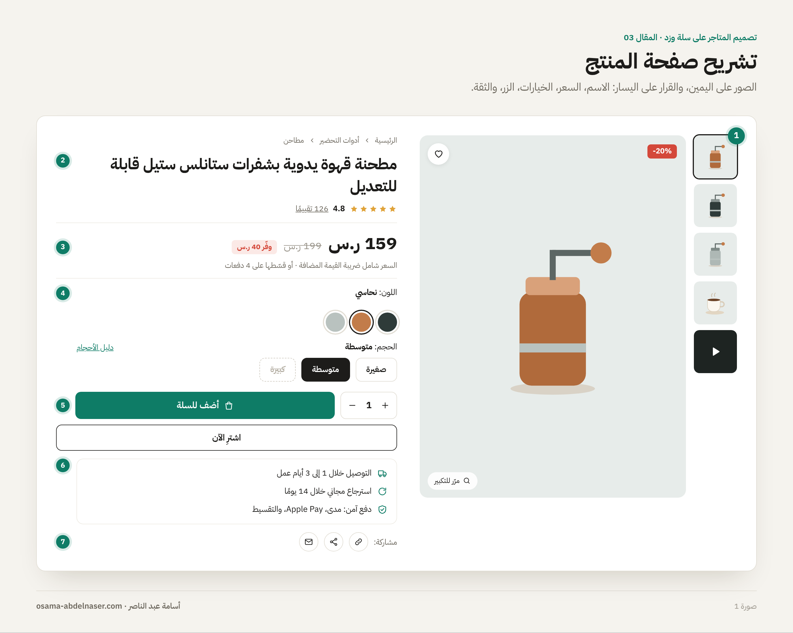
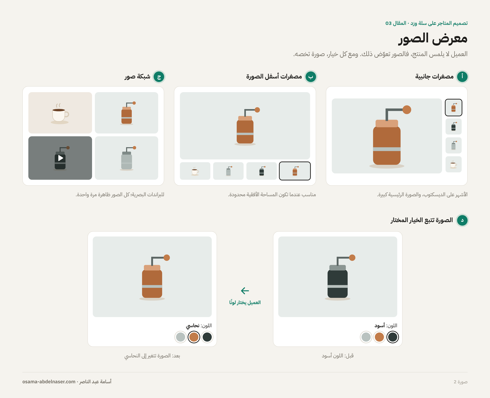
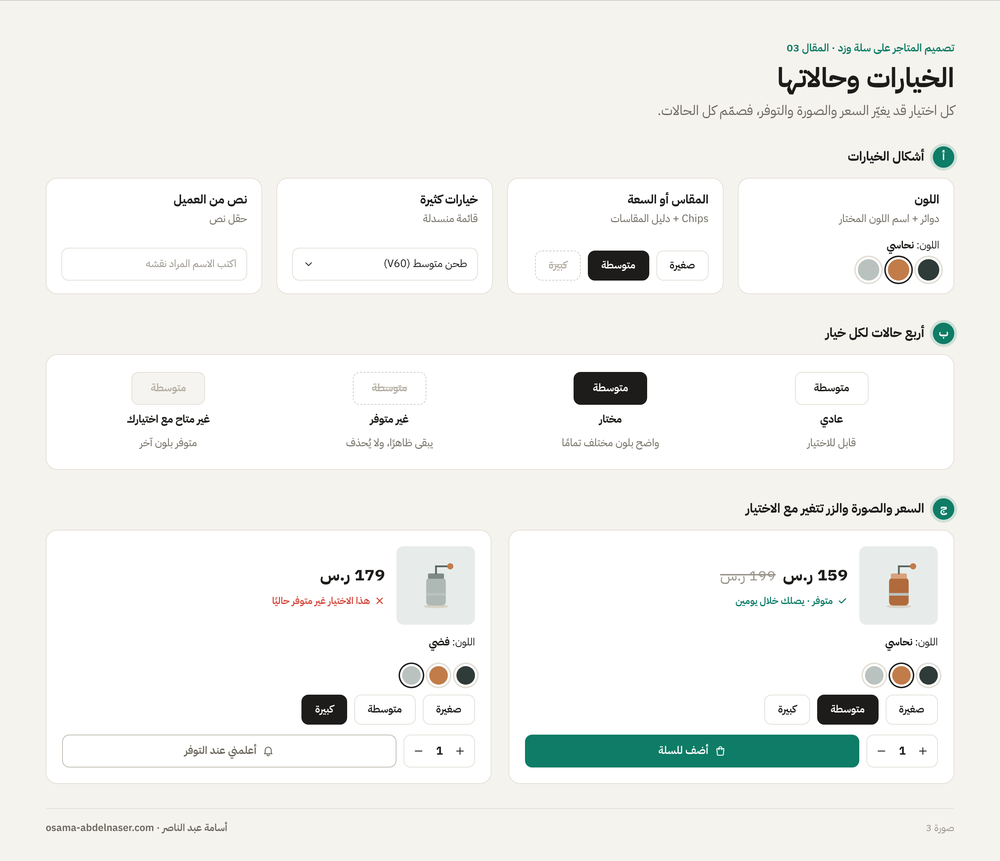
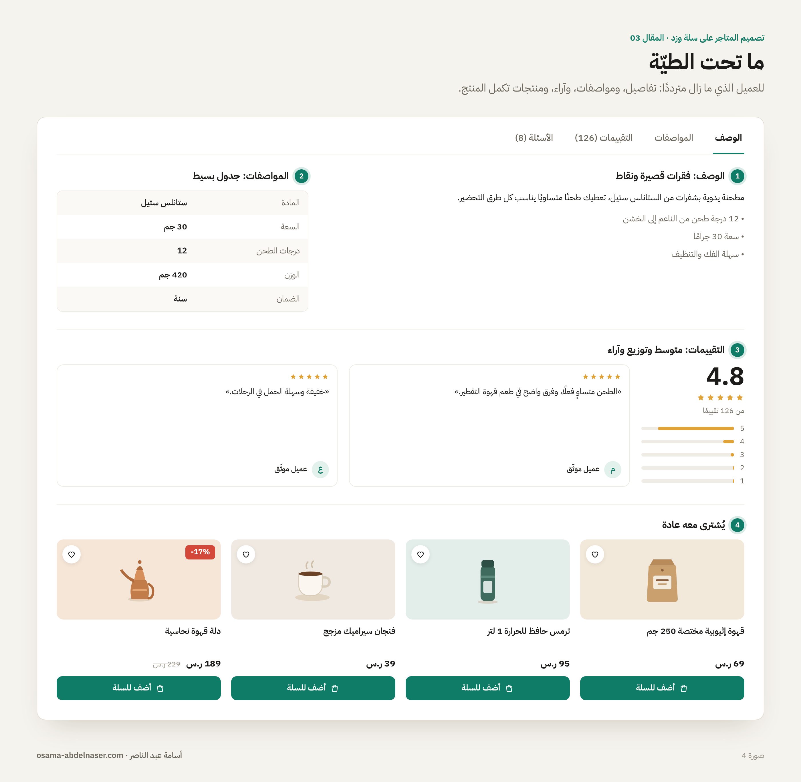
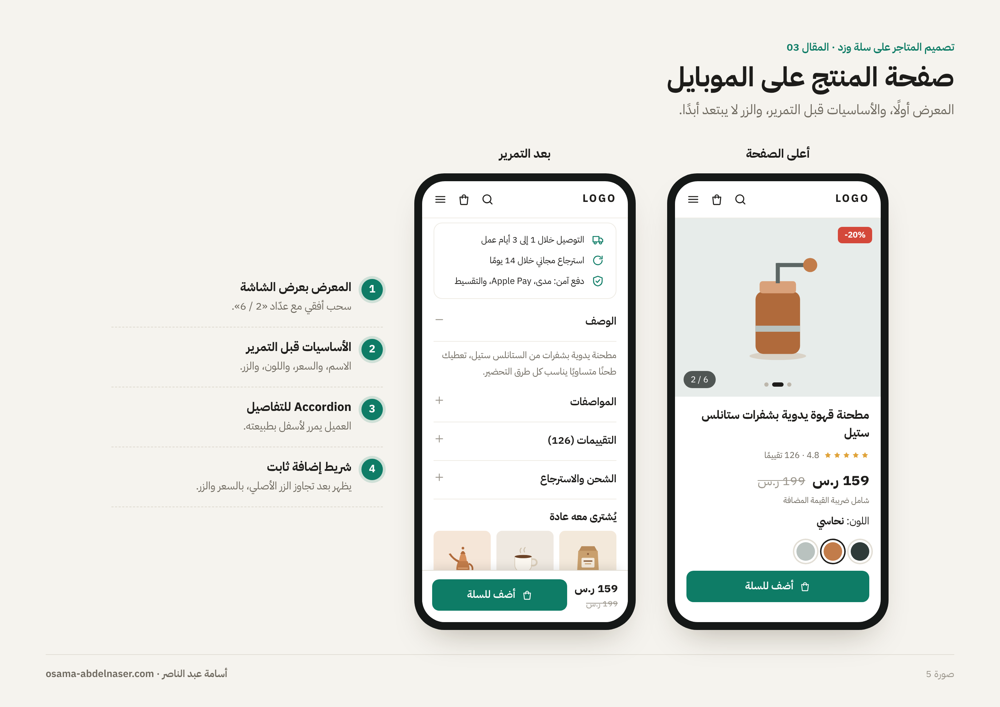

# 03 — صفحة المنتج

**سلسلة تصميم المتاجر الإلكترونية على سلة وزد · المقال 03**
بقلم: أسامة عبد الناصر · مصمم منتجات رقمية UX/UI · نوفمبر 2026

> **ملاحظة مهمة قبل التصميم:** متطلبات مراجعة ثيمات سلة لصفحة المنتج تفصيلية جدًا: عنوان كامل، وصور لا تكسر التصميم مهما اختلفت نسبها، وتغيّر الصورة والسعر وحالة التوفر عند اختيار خيار مختلف، وزر إضافة يتعطل أو يتغير عند نفاد الخيار، ومؤشر «شامل الضريبة» عند الحاجة ([Salla Docs](https://docs.salla.dev/421887m0)). صمّم كل هذه الحالات، وليس الحالة المثالية فقط. التفاصيل في ملف [ملاحظات وتحديثات مهمة](../../NOTES.md).

---

## صفحة القرار

كل ما قبل صفحة المنتج هدفه أن يوصّل العميل إليها. وهنا يقرر: أشتري أم لا؟ لذلك تصميم الصفحة يجيب عن أسئلة العميل بالترتيب الذي يسألها به:

1. **ما هذا؟** الصور والاسم.
2. **بكم؟** السعر، والخصم، وهل يشمل الضريبة.
3. **هل يناسبني؟** الخيارات، والمقاسات، والوصف.
4. **هل أثق فيه؟** التقييمات، والضمان، والاسترجاع.
5. **كيف أحصل عليه؟** زر الإضافة، والشحن، ومدة التوصيل.

## تشريح الصفحة

*صورة 1: تشريح صفحة المنتج على الديسكتوب، والصور على اليمين كما في المتاجر العربية.*

| # | العنصر | ما يجب أن يحققه |
| --- | --- | --- |
| 1 | معرض الصور | كل الصور، بدون كسر التصميم مع اختلاف النسب |
| 2 | الاسم والتقييم | الاسم كاملًا، ورابط سريع للتقييمات |
| 3 | السعر | السعر الحالي، والسعر قبل الخصم، ومؤشر شمول الضريبة |
| 4 | الخيارات | اختيار واضح، وحالة لكل خيار غير متوفر |
| 5 | الكمية والإضافة | زر أساسي واضح، وزر شراء مباشر عند الحاجة |
| 6 | معلومات الثقة | الشحن، والاسترجاع، وطرق الدفع |
| 7 | المشاركة | رابط مباشر وواتساب ومنصات التواصل |

## معرض الصور: المنتج قبل أي كلام

العميل لا يستطيع لمس المنتج، فالصور تعوّض ذلك. متطلبات مراجعة ثيمات سلة تطلب عرض كل صور المنتج دون كسر التصميم مع اختلاف النسب، وتغيير الصورة عند اختيار خيار مختلف، ودعم الفيديو والنماذج ثلاثية الأبعاد ([Salla Docs](https://docs.salla.dev/421887m0)).

- **الصورة الرئيسية كبيرة،** والصور المصغرة بجانبها أو أسفلها.
- **التكبير (Zoom):** عند الـ Hover على الديسكتوب، وبالضغط على الموبايل.
- **الفيديو:** صورة مصغرة بعلامة تشغيل، وليس أول ما يظهر دائمًا.
- **ربط الصور بالخيارات:** عندما يختار العميل «نحاسي»، تظهر صورة المنتج النحاسي.
- **على الموبايل:** سحب أفقي (Swipe) مع نقاط أو عدّاد مثل «2 / 6».

*صورة 2: ثلاثة أشكال لمعرض الصور، وربط الصورة بالخيار المختار.*

## الاسم والسعر: وضوح بدون ذكاء زائد

- **الاسم كاملًا** كما يكتبه التاجر، بدون اختصار.
- **السعر هو أكبر رقم في الصفحة.** السعر قبل الخصم أصغر ومشطوب، ونسبة الخصم أو قيمة التوفير بجانبه.
- **شمول الضريبة:** إذا كانت أسعار المتجر شاملة للضريبة، أضف سطرًا صغيرًا يوضح ذلك. هذا من متطلبات مراجعة ثيمات سلة ([Salla Docs](https://docs.salla.dev/421887m0)).
- **التقسيط:** إن كان المتجر يقدمه، سطر صغير تحت السعر يكفي. لا تجعله ينافس السعر نفسه.

## الخيارات (Variants): أصعب جزء في الصفحة

هنا تقع أغلب الأخطاء. العميل يختار لونًا ومقاسًا وسعة، وكل اختيار قد يغيّر السعر والصورة والتوفر. متطلبات سلة واضحة في هذه النقطة: تحميل أول خيار متوفر عند فتح الصفحة، وتحديث السعر وحالة النفاد حسب الخيار المختار، وتعطيل زر الإضافة أو تغييره عند اختيار خيار غير متوفر ([Salla Docs](https://docs.salla.dev/421887m0)).

| نوع الخيار | الشكل المناسب | ملاحظة |
| --- | --- | --- |
| اللون | دوائر ألوان، مع اسم اللون المختار مكتوبًا | الاسم مهم لمن يصعب عليه تمييز الألوان |
| المقاس أو السعة | Chips | أضف رابط «دليل المقاسات» بجانبها |
| خيارات كثيرة جدًا | قائمة منسدلة | فقط عندما تزيد الاختيارات عن مساحة الـ Chips |
| نص يكتبه العميل | حقل نص | مثل نقش اسم على المنتج |

### حالات كل خيار

صمّم لكل خيار أربع حالات على الأقل: **عادي، ومختار، وغير متوفر، ومُعطّل في هذه التركيبة**. الخيار غير المتوفر يبقى ظاهرًا بخط مشطوب أو لون باهت، ولا يُحذف؛ العميل يحتاج أن يعرف أن المقاس موجود لكنه نفد.

*صورة 3: أشكال الخيارات، وحالاتها الأربع، وكيف يتغير زر الإضافة مع خيار غير متوفر.*

## زر الإضافة ومعلومات الثقة

- **زر «أضف للسلة»** هو الأبرز في الصفحة بعد السعر.
- **زر «اشترِ الآن»** للانتقال المباشر للدفع. متطلبات سلة تطلب أزرار الدفع المباشر مفعّلة افتراضيًا ([Salla Docs](https://docs.salla.dev/421887m0)).
- **الكمية:** بجانب الزر، بأزرار + و−.
- **معلومات الثقة أسفل الزر مباشرة:** مدة التوصيل، وسياسة الاسترجاع، وطرق الدفع. هذا هو المكان الذي يتردد فيه العميل، فأجب عن تردده هنا.

## ما تحت الطيّة: الوصف والتقييمات والمنتجات المشابهة

بعد الجزء العلوي، العميل الذي ما زال مترددًا يبحث عن تفاصيل أكثر:

1. **الوصف:** فقرات قصيرة ونقاط، وليس جدارًا من النص.
2. **المواصفات:** جدول بسيط من عمودين.
3. **طريقة الاستخدام أو العناية:** عند الحاجة.
4. **التقييمات والأسئلة:** متوسط التقييم، وتوزيع النجوم، والآراء مع صور العملاء. في زد توجد قوالب مستقلة لتقييمات المنتج وأسئلته ([Zid Docs](https://docs.zid.sa/overview-1379323m0)).
5. **منتجات مشابهة أو تكمل المنتج:** «يُشترى معه عادة» أقوى من «قد يعجبك».

**Tabs أم Accordion؟** على الديسكتوب يمكن استخدام Tabs للوصف والمواصفات والتقييمات. على الموبايل، Accordion أفضل؛ لأن العميل يمرر لأسفل بطبيعته.

*صورة 4: ترتيب ما تحت الطيّة: الوصف والمواصفات والتقييمات والمنتجات المشابهة.*

## الموبايل: الزر يجب أن يبقى قريبًا

على الموبايل، المعرض يأخذ عرض الشاشة كاملًا، والمعلومات تأتي تحته. أهم قرار هنا: **شريط إضافة ثابت (Sticky Add to Cart)** يظهر أسفل الشاشة عندما يمرر العميل بعد الزر الأصلي، ويحمل السعر وزر الإضافة.

*صورة 5: صفحة المنتج على الموبايل، والشريط الثابت، وAccordion للتفاصيل.*

## قائمة مراجعة قبل تسليم صفحة المنتج

- [ ] المعرض مُختبر مع صورة واحدة، ومع 8 صور، ومع صور بنسب مختلفة.
- [ ] الصورة تتغير عند اختيار خيار له صورة خاصة.
- [ ] الاسم يظهر كاملًا، والسعر أكبر رقم في الصفحة.
- [ ] مؤشر «شامل الضريبة» مصمم عند الحاجة.
- [ ] كل خيار له حالات: عادي، ومختار، وغير متوفر.
- [ ] زر الإضافة له حالة عند نفاد التركيبة المختارة.
- [ ] السعر وحالة التوفر يتحدثان مع تغيير الخيار.
- [ ] معلومات الشحن والاسترجاع أسفل الزر مباشرة.
- [ ] التقييمات لها حالة فارغة («كن أول من يقيّم»).
- [ ] شريط الإضافة الثابت مصمم للموبايل.
- [ ] المشاركة متاحة: رابط مباشر وواتساب.

## المصادر

- [Salla Docs: UI / UX Review](https://docs.salla.dev/421887m0)
- [Zid Docs: Templates Overview](https://docs.zid.sa/overview-1379323m0)

---

**المقال السابق:** [02 — صفحة قائمة المنتجات](../02-product-listing/README.md) · **المقال التالي:** [04 — السلة وإتمام الطلب](../04-cart-checkout/README.md)

