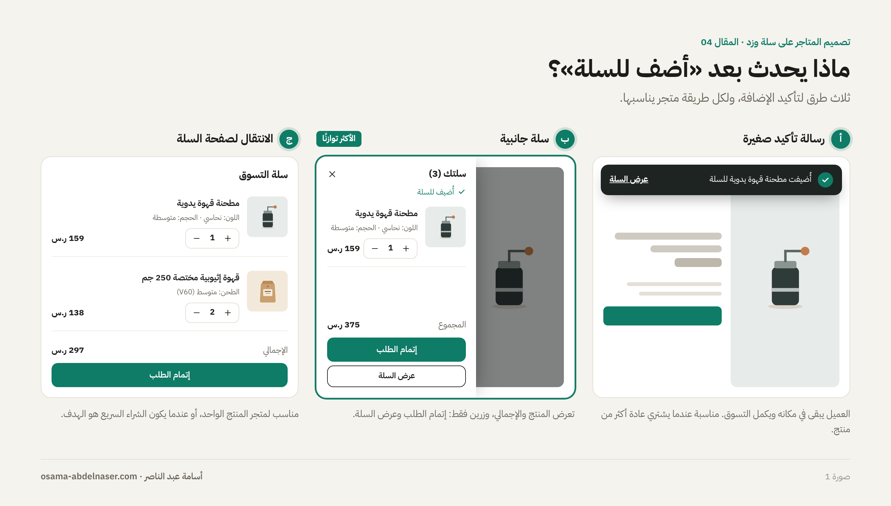
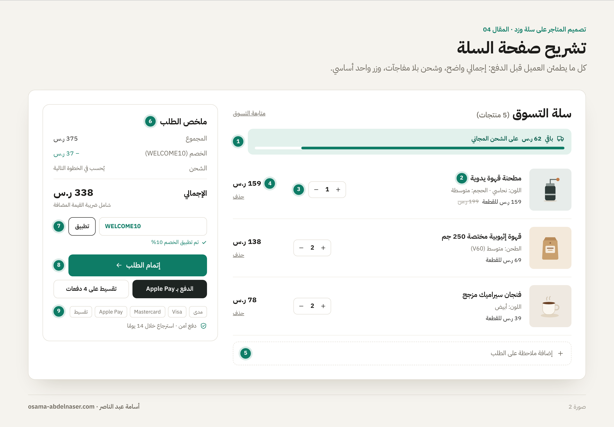
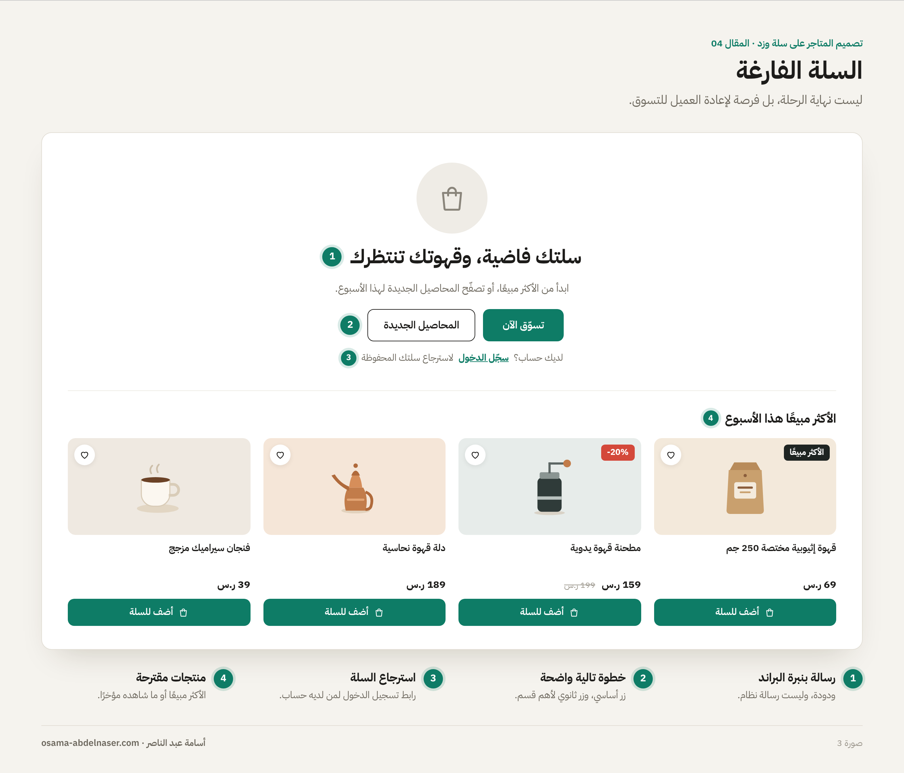
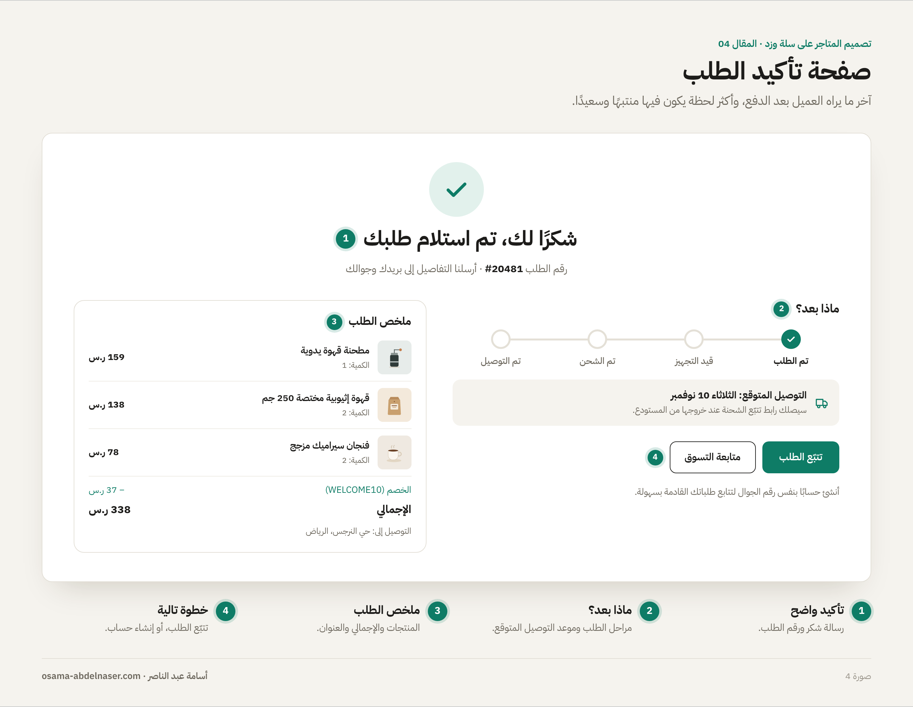
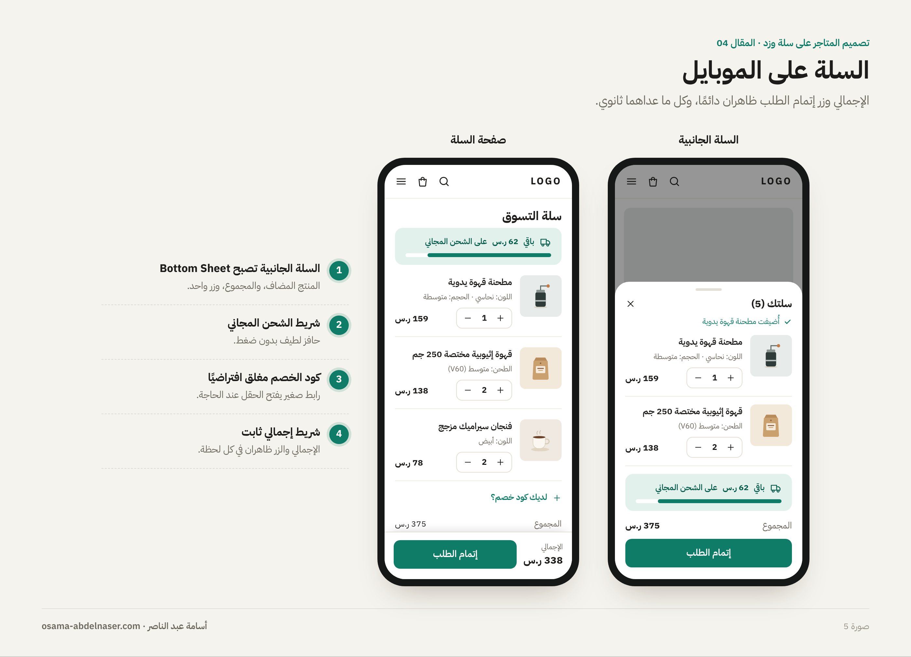

# 04 — السلة وإتمام الطلب

**سلسلة تصميم المتاجر الإلكترونية على سلة وزد · المقال 04**
بقلم: أسامة عبد الناصر · مصمم منتجات رقمية UX/UI · نوفمبر 2026

**[اقرأ المقال على موقع السلسلة ←](https://osa98.github.io/salla-zid-ecommerce-design/04-cart-checkout.html)**

> **ملاحظة مهمة قبل التصميم:** قوائم صفحات الثيم في وثائق سلة (Twilight React) وزد (Vitrin) تتضمن صفحة السلة وصفحة تأكيد الطلب، لكنها لا تتضمن صفحة إتمام الطلب (Checkout) نفسها ([Salla Docs: Routes](https://docs.salla.dev/twilight/react/routes) · [Zid Docs: Templates](https://docs.zid.sa/overview-1379323m0)). لذلك مساحة تحكمك الأكبر كمصمم هي السلة وصفحة الشكر. لا تفترض أن خطوات الدفع قابلة لإعادة التصميم قبل أن تتأكد مع المطور. التفاصيل في ملف [ملاحظات وتحديثات مهمة](../../NOTES.md).

---

## آخر صفحة تتحكم فيها بالكامل

العميل قرر أن يشتري. مهمة السلة الآن بسيطة وحساسة في نفس الوقت: **لا تعطيه سببًا للتراجع.** أي مفاجأة في السعر، أو زر غير واضح، أو خطوة زائدة، قد تكون سببًا لترك السلة.

وفي سلة وزد تحديدًا، السلة غالبًا آخر صفحة يتحكم الثيم في تصميمها قبل الدفع. لذلك كل ما يطمئن العميل يجب أن يكون هنا: الإجمالي الواضح، وتكلفة الشحن، وطرق الدفع، والخصم.

## سلة جانبية أم صفحة سلة؟

بعد الضغط على «أضف للسلة»، أمامك ثلاثة خيارات لما يحدث:

| الطريقة | ماذا يحدث | متى تناسب |
| --- | --- | --- |
| رسالة تأكيد صغيرة (Toast) | رسالة «أُضيف للسلة» ويبقى العميل في مكانه | عندما يشتري العميل عادة أكثر من منتج |
| سلة جانبية (Cart Drawer) | تُفتح من الجانب بالمنتجات والإجمالي | الأكثر توازنًا لأغلب المتاجر |
| الانتقال لصفحة السلة | ينتقل العميل مباشرة | متجر المنتج الواحد، أو الشراء السريع |

*صورة 1: ثلاث طرق لتأكيد الإضافة للسلة: رسالة صغيرة، وسلة جانبية، وصفحة السلة.*

**السلة الجانبية الجيدة** تعرض المنتج المضاف، وتسمح بتعديل الكمية، وتعرض الإجمالي، وفيها زران فقط: «إتمام الطلب» و«عرض السلة».

## تشريح صفحة السلة

متطلبات مراجعة ثيمات سلة لصفحة السلة واضحة: اسم المنتج، وسعر القطعة، والصورة، والسعر الإجمالي للسطر، والكمية قابلة للتعديل، والإجمالي ظاهرًا، ومؤشر شمول الضريبة، وزر إتمام الطلب، وتحديث الأسعار عند تغيير الكمية. ومن المميزات المطلوبة: ملاحظات الطلب، وأكواد الخصم، وأزرار الدفع المباشر ([Salla Docs](https://docs.salla.dev/421887m0)).

*صورة 2: تشريح صفحة السلة على الديسكتوب.*

| # | العنصر | ملاحظة تصميمية |
| --- | --- | --- |
| 1 | شريط الشحن المجاني | «باقي 62 ر.س على الشحن المجاني» يرفع قيمة الطلب بلطف |
| 2 | سطر المنتج | الصورة، والاسم، والخيار المختار، وسعر القطعة |
| 3 | الكمية والحذف | أزرار + و−، وحذف واضح مع إمكانية التراجع |
| 4 | إجمالي السطر | يتحدث فورًا مع تغيير الكمية |
| 5 | ملاحظات الطلب | حقل اختياري، مغلق افتراضيًا |
| 6 | ملخص الطلب | المجموع، والخصم، والشحن، والإجمالي شامل الضريبة |
| 7 | كود الخصم | حقل وزر «تطبيق»، مع رسالة نجاح أو خطأ واضحة |
| 8 | إتمام الطلب | أوضح زر في الصفحة، وتحته أزرار الدفع المباشر |
| 9 | طرق الدفع والثقة | أيقونات الدفع، والدفع الآمن، والاسترجاع |

### قواعد تمنع التراجع

- **لا مفاجآت في السعر:** إذا كان الشحن يُحسب لاحقًا، اكتب ذلك صراحة: «يُحسب الشحن في الخطوة التالية».
- **الإجمالي هو أكبر رقم** في الملخص، ومعه «شامل الضريبة» إذا كانت الأسعار شاملة.
- **كود الخصم لا يسرق الانتباه:** حقل صغير أو رابط «لديك كود خصم؟» يفتحه. حقل كبير وفارغ يجعل العميل يغادر ليبحث عن كود.
- **الحذف قابل للتراجع:** رسالة «تم حذف المنتج · تراجع» أفضل من نافذة تأكيد.
- **زر واحد أساسي:** «إتمام الطلب» فقط. «متابعة التسوق» رابط ثانوي.

## السلة الفارغة

السلة الفارغة ليست نهاية الرحلة. هي فرصة لإعادة العميل للتسوق:

- رسالة ودودة بنبرة البراند، مثل «سلتك فاضية، وقهوتك تنتظرك».
- زر واضح للعودة للتسوق، أو لأهم قسم في المتجر.
- منتجات مقترحة: الأكثر مبيعًا، أو ما شاهده العميل مؤخرًا.
- إذا كان العميل غير مسجل، رابط لتسجيل الدخول؛ ربما سلته محفوظة في حسابه.

*صورة 3: سلة فارغة تعيد العميل للتسوق بدل أن تتركه أمام صفحة بيضاء.*

## صفحة تأكيد الطلب: آخر انطباع

صفحة الشكر من صفحات الثيم في سلة ([Salla Docs: Routes](https://docs.salla.dev/twilight/react/routes))، وهي آخر ما يراه العميل بعد الدفع. أغلب المتاجر تهملها، وهي من أكثر اللحظات التي يكون فيها العميل سعيدًا ومنتبهًا.

- **تأكيد واضح:** «تم استلام طلبك» مع رقم الطلب.
- **ماذا بعد؟** موعد التوصيل المتوقع، وأين سيصل إشعار الشحن.
- **ملخص الطلب:** المنتجات والإجمالي وعنوان التوصيل.
- **خطوة تالية مفيدة:** تتبّع الطلب، أو إنشاء حساب لتتبّع الطلبات، أو منتجات تكمل ما اشتراه.
- **نبرة البراند:** هذه أفضل لحظة لرسالة شكر حقيقية بأسلوب المتجر.

*صورة 4: صفحة تأكيد الطلب: تأكيد، وماذا بعد، وملخص، وخطوة تالية.*

## الموبايل: الإجمالي والزر دائمًا ظاهران

على الموبايل، ملخص الطلب ينتقل أسفل المنتجات. لكن العميل يجب أن يرى الإجمالي وزر إتمام الطلب في كل لحظة، فاجعلهما في **شريط ثابت** أسفل الشاشة.

*صورة 5: السلة الجانبية وصفحة السلة على الموبايل، مع شريط الإجمالي الثابت.*

## قائمة مراجعة قبل تسليم السلة

- [ ] طريقة تأكيد الإضافة للسلة محددة: رسالة، أو سلة جانبية، أو صفحة.
- [ ] كل سطر منتج فيه: الصورة، والاسم، والخيار المختار، وسعر القطعة، والكمية، وإجمالي السطر.
- [ ] الأسعار والإجمالي يتحدثان فورًا مع تغيير الكمية.
- [ ] الإجمالي شامل الضريبة مكتوب بوضوح، والشحن ليس مفاجأة.
- [ ] كود الخصم له حالة نجاح وحالة خطأ.
- [ ] ملاحظات الطلب وأزرار الدفع المباشر موجودة.
- [ ] زر «إتمام الطلب» هو الأوضح، و«متابعة التسوق» رابط ثانوي.
- [ ] الحذف قابل للتراجع.
- [ ] السلة الفارغة مصممة بخطوة تالية ومنتجات مقترحة.
- [ ] صفحة تأكيد الطلب مصممة.
- [ ] شريط الإجمالي والزر ثابت على الموبايل.
- [ ] تم التأكد مع المطور مما يتحكم فيه الثيم في خطوات الدفع.

## المصادر

- [Salla Docs: UI / UX Review](https://docs.salla.dev/421887m0)
- [Salla Docs: Twilight React Routes](https://docs.salla.dev/twilight/react/routes)
- [Zid Docs: Templates Overview](https://docs.zid.sa/overview-1379323m0)

---

**المقال السابق:** [03 — صفحة المنتج](../03-product-page/README.md) · **المقال التالي:** [05 — Design System والتسليم للمطور](../05-design-system-handoff/README.md)

