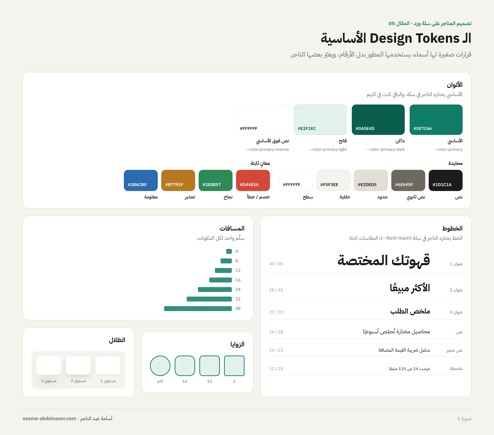
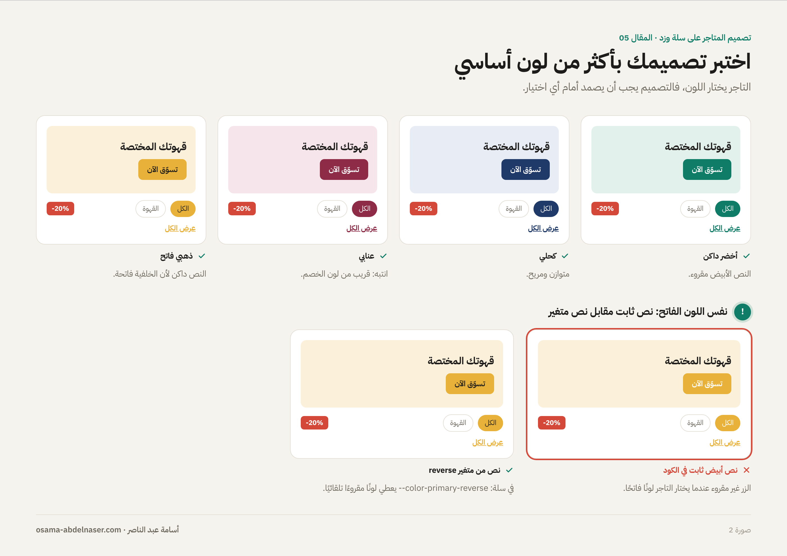
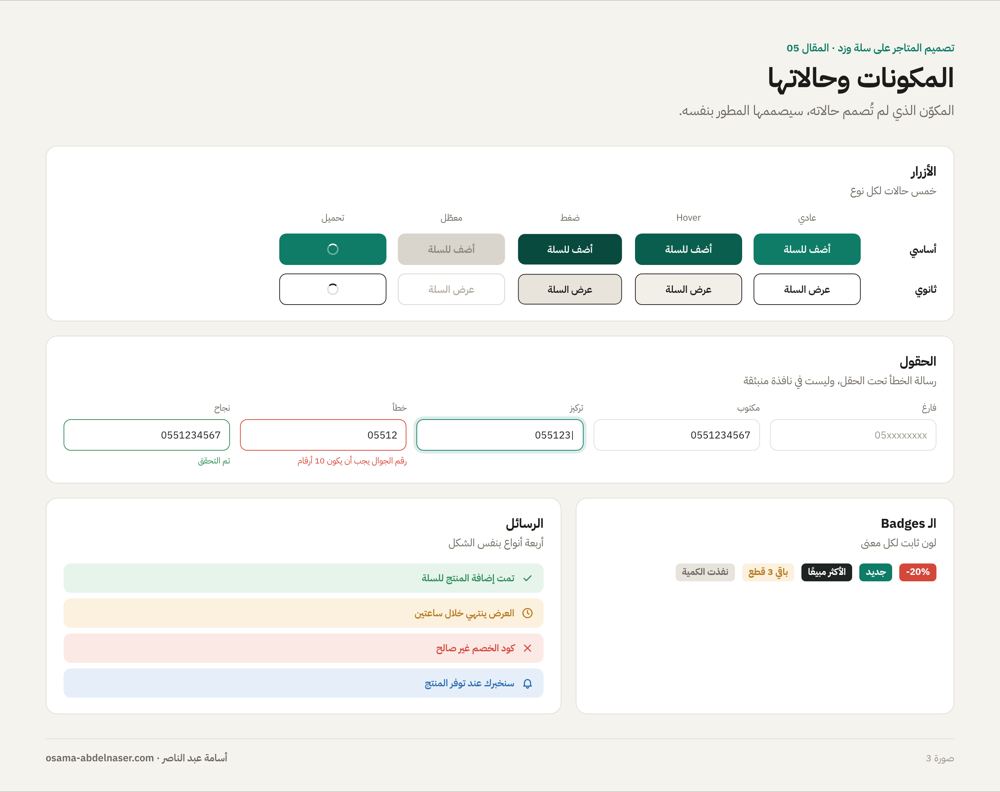
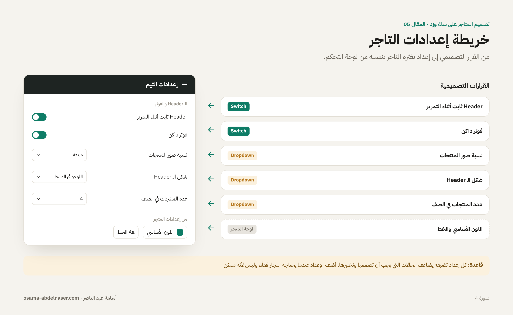
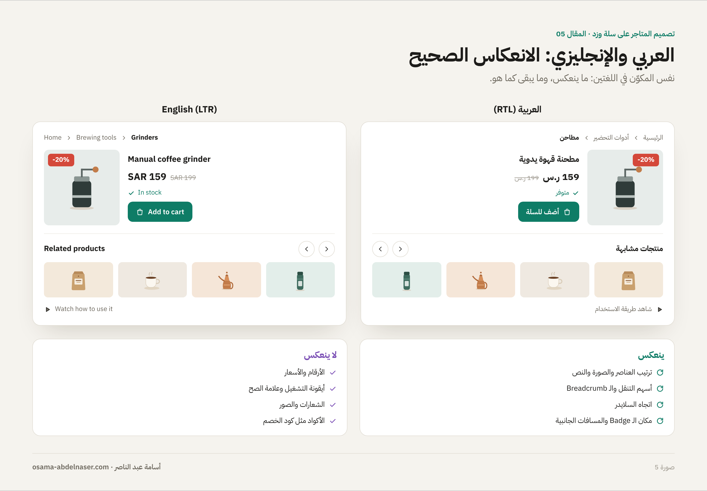
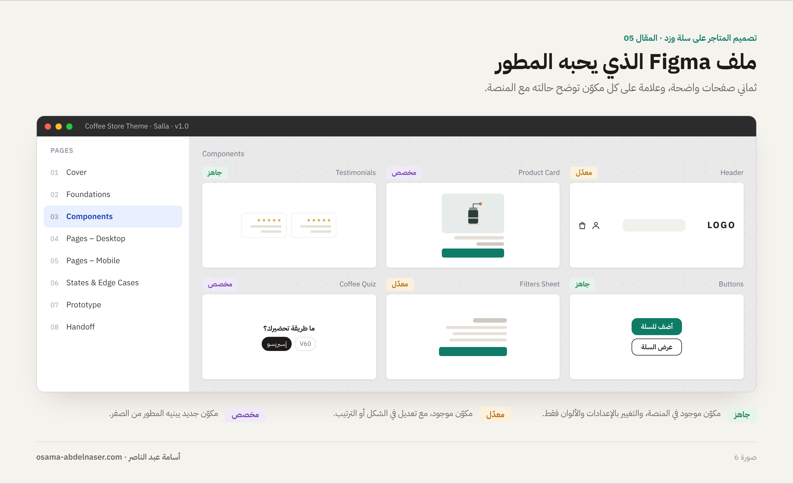

# 05 — Design System والتسليم للمطور على سلة وزد

**سلسلة تصميم المتاجر الإلكترونية على سلة وزد · المقال 05**
بقلم: أسامة عبد الناصر · مصمم منتجات رقمية UX/UI · نوفمبر 2026

**[اقرأ المقال على موقع السلسلة ←](https://osa98.github.io/salla-zid-ecommerce-design/05-design-system-handoff.html)**

> **ملاحظة مهمة قبل التصميم:** في ثيمات سلة الجديدة (Twilight React)، التاجر يختار اللون الأساسي والخط من لوحة التحكم، والمحرك يحوّلهما إلى متغيرات مثل `--color-primary` و`--font-main` يستخدمها الثيم ([Salla Docs: Styling](https://docs.salla.dev/twilight/react/guide/styling)). وزد توصي بنفس الفكرة: الألوان والخطوط تُسحب من إعدادات الثيم ولا تُثبّت في الكود ([Zid Docs](https://docs.zid.sa/theme-development.md)). معنى ذلك أن **اللون الذي اخترته في Figma قد لا يكون اللون الذي سيراه العميل.** صمّم على هذا الأساس. التفاصيل في ملف [ملاحظات وتحديثات مهمة](../../NOTES.md).

---

## الثيم نظام، وليس صفحات مرسومة

في موقع عادي، تسلّم صفحات مرسومة والمطور ينفذها كما هي. في ثيم سلة أو زد الأمر مختلف: التاجر سيغيّر اللون والخط، ويرفع صورًا لا تعرفها، ويُظهر أقسامًا ويخفي أخرى. لذلك ما تسلّمه فعليًا هو **نظام**: قواعد ومكونات تعمل مهما تغيّر المحتوى.

هذا المقال عن تحويل تصميمك إلى نظام يفهمه المطور، ويصمد أمام تعديلات التاجر.

## 1. Design Tokens: القرارات الصغيرة التي تتكرر

الـ Token هو قرار تصميمي له اسم: «اللون الأساسي»، «مسافة متوسطة»، «زاوية الكارت». بدل أن يكتب المطور رقمًا في كل مكان، يستخدم الاسم. وعندما يتغير القرار، يتغير في كل المتجر.

*صورة 1: الـ Tokens الأساسية: الألوان، والخطوط، والمسافات، والزوايا، والظلال.*

| المجموعة | ماذا تحدد | ملاحظة لسلة وزد |
| --- | --- | --- |
| الألوان الأساسية | اللون الأساسي ودرجاته، ولون النص فوقه | في سلة يختارها التاجر: `--color-primary` ودرجاته الفاتحة والداكنة، و`--color-primary-reverse` للنص فوقه |
| الألوان المحايدة | الخلفيات، والحدود، والنصوص | ثابتة غالبًا في الثيم |
| ألوان المعاني | الخصم، والنجاح، والتحذير، والخطأ | لا تربطها باللون الأساسي؛ الأحمر للخصم يبقى أحمر |
| الخطوط | الخط، والأحجام، والأوزان، وارتفاع السطر | في سلة يختار التاجر الخط: `--font-main`؛ صمّم بمقاسات تعمل مع أكثر من خط |
| المسافات | سلّم ثابت مثل 4، 8، 12، 16، 24، 32 | استخدم نفس السلّم في كل المكونات |
| الزوايا والظلال | زاوية الأزرار والكروت، ومستويات الظل | قليلة وواضحة: مستويان أو ثلاثة للظل |

## 2. اختبر تصميمك بأكثر من لون أساسي

لأن التاجر يختار اللون الأساسي، اختبر تصميمك بأربعة ألوان مختلفة على الأقل قبل التسليم: لون داكن، ولون فاتح، ولون مشبع، ولون قريب من لون الخصم. اسأل في كل مرة:

- هل النص فوق الأزرار مقروء؟ (لهذا يوجد `--color-primary-reverse` في سلة).
- هل يختلط اللون الأساسي مع لون الخصم أو الخطأ؟
- هل يبقى التصميم متوازنًا إذا اختار التاجر لونًا صارخًا؟

*صورة 2: نفس التصميم بأربعة ألوان أساسية، وحالة فشل عندما يُكتب نص أبيض ثابت فوق لون فاتح.*

**الوضع الداكن:** محرك سلة الجديد لا يوفر ثيمًا داكنًا جاهزًا، وكثير من الثيمات تكتفي بخيار فوتر داكن ([Salla Docs: Styling](https://docs.salla.dev/twilight/react/guide/styling)). لا تعد التاجر بوضع داكن كامل قبل الاتفاق مع المطور.

## 3. المكونات وحالاتها

المكوّن الذي لم تُصمم حالاته سيصممها المطور بنفسه، غالبًا بشكل لا يشبه تصميمك. لكل مكوّن تفاعلي، صمّم:

| المكوّن | الحالات المطلوبة |
| --- | --- |
| الأزرار | عادي، وHover، وضغط، ومعطّل، وتحميل |
| الحقول | فارغ، ومكتوب، وتركيز (Focus)، وخطأ مع رسالة، ونجاح |
| الـ Product Card | عادي، وخصم، وكمية قليلة، ونفذت الكمية، واسم طويل |
| الخيارات | عادي، ومختار، وغير متوفر |
| الـ Badges | خصم، وجديد، والأكثر مبيعًا، ونفذت الكمية |
| الرسائل | نجاح، وتحذير، وخطأ، ومعلومة |

*صورة 3: الأزرار والحقول والـ Badges والرسائل بكل حالاتها.*

## 4. ما الذي سيغيّره التاجر؟ خريطة الإعدادات

قبل التسليم، اكتب قائمة بكل قرار تصميمي يجب أن يكون **إعدادًا** يغيّره التاجر، وكل قرار يبقى **ثابتًا** في الثيم. هذه القائمة يحتاجها المطور ليبني لوحة إعدادات الثيم.

في ثيمات سلة الجديدة، أنواع الإعدادات الموثقة حاليًا: مفتاح تشغيل وإيقاف (Switch)، وقائمة اختيارات (Dropdown)، وعناوين وفواصل لتنظيم لوحة التحكم ([Salla Docs: Settings](https://docs.salla.dev/twilight/react/guide/settings)). صمّم خياراتك بنفس المنطق:

| القرار التصميمي | نوع الإعداد | مثال |
| --- | --- | --- |
| Header ثابت أثناء التمرير | Switch | تشغيل / إيقاف |
| فوتر داكن أو فاتح | Switch | تشغيل / إيقاف |
| نسبة صور المنتجات | Dropdown | مربعة / طولية / عرضية |
| شكل الـ Header | Dropdown | اللوجو في الوسط / اللوجو في الجانب |
| عدد المنتجات في الصف | Dropdown | 3 / 4 |
| اللون الأساسي والخط | من لوحة تحكم المتجر | يختارهما التاجر من إعدادات المتجر |

*صورة 4: من القرار التصميمي إلى إعداد في لوحة تحكم التاجر.*

**قاعدة:** كل إعداد تضيفه يضاعف الحالات التي يجب أن تصممها وتختبرها. أضف الإعداد عندما يحتاجه التجار فعلًا، وليس لأنه ممكن.

## 5. العربي والإنجليزي: الانعكاس الصحيح

أغلب متاجر سلة وزد بلغتين، والتصميم ينعكس بالكامل بين RTL وLTR. وثائق سلة توصي المطورين باستخدام خصائص منطقية مثل «بداية» و«نهاية» بدل «يمين» و«يسار» حتى يعمل نفس التصميم في اللغتين ([Salla Docs: Styling](https://docs.salla.dev/twilight/react/guide/styling)). على المصمم أن يحدد ما ينعكس وما لا ينعكس:

- **ينعكس:** ترتيب العناصر، والأسهم التي تدل على الاتجاه (التالي والسابق)، والسلايدرات، والمسافات الجانبية، وموضع الأيقونة داخل الزر.
- **لا ينعكس:** الأرقام والأسعار، وأيقونة التشغيل، وعلامة الصح، والشعارات، والصور.

*صورة 5: نفس المكوّن بالعربي والإنجليزي، وما ينعكس وما لا ينعكس.*

## 6. ملف Figma الذي يحبه المطور

ملف Figma المنظم يوفر ساعات من الأسئلة. هذا الهيكل الذي أستخدمه في مشاريعي:

1. **Cover:** اسم المشروع، والمنصة (سلة أو زد)، والإصدار، والتاريخ.
2. **Foundations:** الـ Tokens: الألوان، والخطوط، والمسافات، والزوايا، والظلال، والأيقونات.
3. **Components:** كل المكونات بكل حالاتها، باستخدام Variants.
4. **Pages – Desktop:** كل الصفحات على الديسكتوب.
5. **Pages – Mobile:** كل الصفحات على الموبايل.
6. **States & Edge Cases:** الحالات الفارغة، والأخطاء، والأسماء الطويلة، والصور غير المتناسقة.
7. **Prototype:** الرحلات الأساسية: من الصفحة الرئيسية حتى السلة.
8. **Handoff:** ملاحظات التنفيذ، وحالة كل مكوّن.

### حالة كل مكوّن

بجانب كل مكوّن، ضع علامة توضح حالته مع المنصة، بنفس سلّم القرار من [المقال الأول](../01-homepage/README.md):

- **جاهز:** مكوّن موجود في المنصة، والتغيير بالإعدادات والألوان فقط.
- **معدّل:** مكوّن موجود، مع تعديل في الشكل أو الترتيب.
- **مخصص:** مكوّن جديد يبنيه المطور من الصفر.

*صورة 6: هيكل ملف Figma للتسليم، وعلامات حالة المكونات.*

## ماذا تسلّم؟

- [ ] رابط ملف Figma منظم بالهيكل أعلاه.
- [ ] جدول الـ Tokens: الألوان والخطوط والمسافات بأسمائها.
- [ ] قائمة المكونات مع حالة كل مكوّن: جاهز، أو معدّل، أو مخصص.
- [ ] خريطة إعدادات التاجر: ما يتغير وما يبقى ثابتًا.
- [ ] الأيقونات بصيغة SVG، والصور مضغوطة ومناسبة للويب.
- [ ] اسم الخط ورخصة استخدامه على الويب.
- [ ] تصميم الحالات الفارغة والأخطاء والأسماء الطويلة.
- [ ] اختبار التصميم بأربعة ألوان أساسية مختلفة.
- [ ] نسخة RTL ونسخة LTR للصفحات الأساسية.
- [ ] دليل تصوير مختصر للتاجر.

## الخلاصة

التصميم الجميل في Figma ليس نهاية العمل على سلة وزد. النهاية الحقيقية متجر يعمل بشكل جميل بعد أن يغيّر التاجر لونه، ويرفع صوره، ويكتب أسماء منتجاته الطويلة. صمّم النظام، لا الصورة.

## المصادر

- [Salla Docs: Styling](https://docs.salla.dev/twilight/react/guide/styling)
- [Salla Docs: Settings](https://docs.salla.dev/twilight/react/guide/settings)
- [Zid Docs: Theme Development](https://docs.zid.sa/theme-development.md)

---

**المقال السابق:** [04 — السلة وإتمام الطلب](../04-cart-checkout/README.md) · **القادم:** 06 — دراسة حالة (قريبًا)

